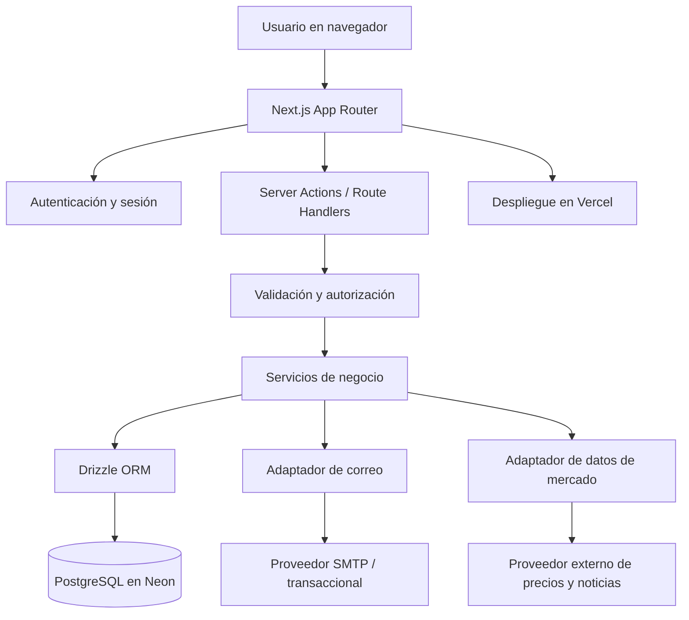
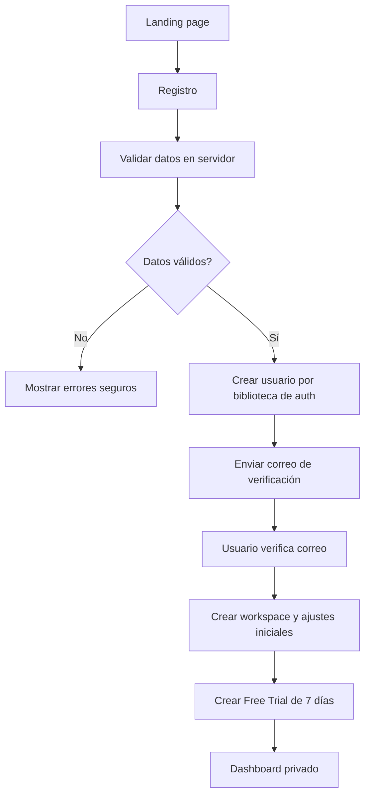
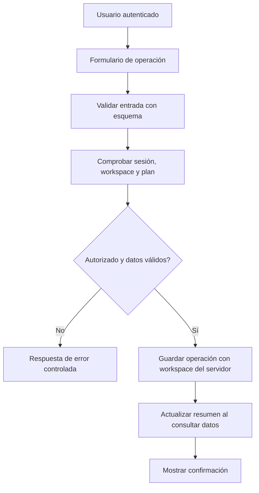
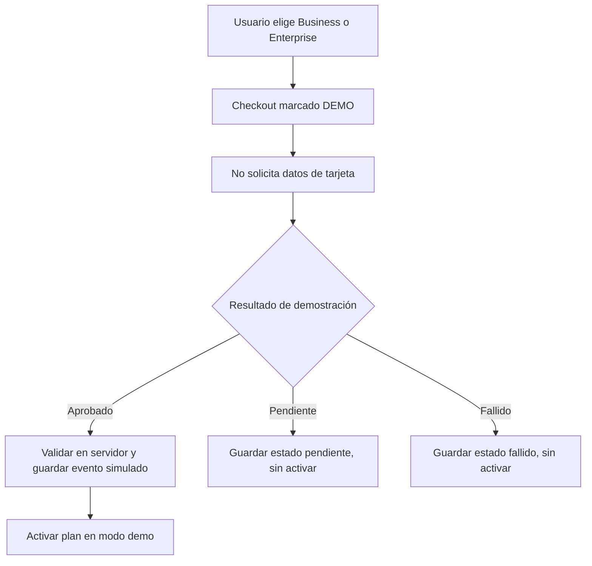
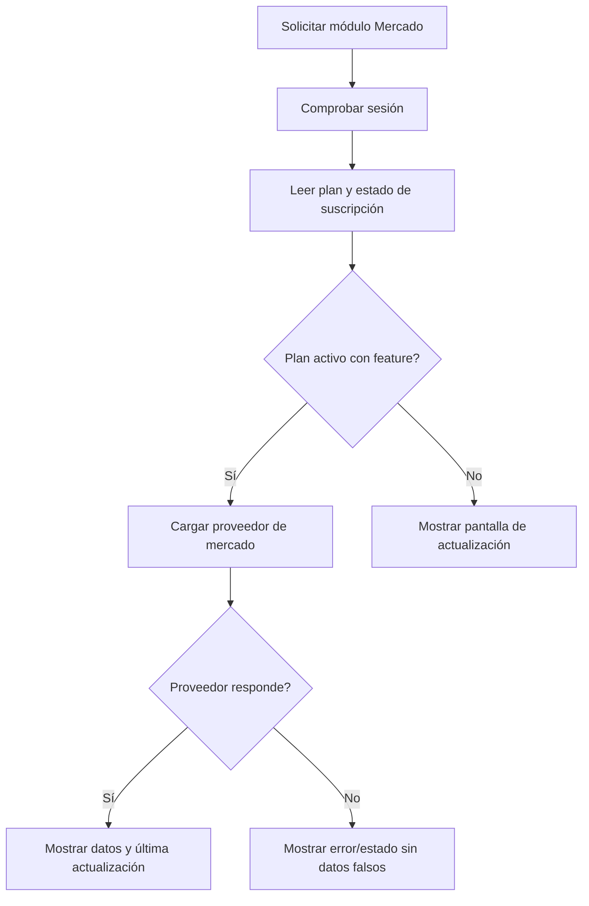

# Cyclon P2P — Plan de ingeniería y guía de implementación para Antigravity

**Tipo de proyecto:** mini-SaaS / MVP de portafolio  
**Producto:** dashboard para registrar y analizar operaciones P2P de exchanges  
**Estado del documento:** especificación de ingeniería para un MVP de portafolio  
**Objetivo:** desarrollar por fases un SaaS de demostración verificable, con pagos y promociones simulados claramente identificados, panel Master exclusivo para el propietario, configuración de comisiones por país y exportaciones Excel; no procesa dinero ni calcula impuestos reales.

---

**Alcance revisado:** demo SaaS para portafolio; checkout simulado; bancos y métodos configurados por cada comerciante; países iniciales VE, CO, BR, AR, EC, PE y CL; comisiones configurables por país; exportaciones Excel; panel Master del propietario para clientes, planes, métricas de suscripción y promociones.

## 0. Instrucción principal para el agente

Actúa como ingeniero de software senior, arquitecto full-stack y responsable de calidad. Usa este documento como fuente principal para implementar **Cyclon P2P**. Trabaja por fases, no intentes producir toda la aplicación en un único cambio masivo.

Al comenzar:

1. Inspecciona el repositorio, las carpetas existentes, el `package.json`, las variables de entorno de ejemplo, los scripts, los tests y el estado de Git. No sobrescribas archivos ni código existente sin entender su función.
2. Compara el estado real del repositorio con las fases de este documento. Identifica qué existe, qué falta y qué debe conservarse.
3. Si el repositorio está vacío, crea la base técnica descrita abajo. Si ya existe una implementación, reutiliza lo que esté bien resuelto y documenta cualquier desviación importante.
4. Implementa una fase a la vez. Antes de cada fase, deja claro el objetivo y los archivos principales que cambiarás; al terminar, ejecuta las verificaciones aplicables, corrige los errores y registra el resultado.
5. No marques una fase como completa si sus criterios de aceptación no se cumplen. No afirmes que una prueba, integración o despliegue funcionó si no se ejecutó y verificó.
6. Ante una decisión de negocio no especificada, aplica las recomendaciones explícitas de este documento y registra el supuesto. No inventes tarifas oficiales, impuestos, precios de mercado ni catálogos bancarios completos. Los datos ficticios de demostración deben identificarse como tales en el código, la UI y la documentación.
7. Consulta la documentación oficial vigente cuando debas elegir versiones o integrar servicios externos. Registra la decisión técnica y el motivo en `docs/decisions/`.

### Reglas que no se deben romper

- La primera versión es una **bitácora y dashboard de operaciones P2P**; no ejecuta compras, ventas, transferencias ni órdenes en los exchanges.
- No pedir ni almacenar claves API de Binance, Bybit o Bitget. No hacer trading automático.
- Cada consulta y mutación de datos privados de comerciante debe estar vinculada al espacio de trabajo autenticado del usuario. No confiar en un `workspaceId` enviado por el navegador. Las consultas globales del SaaS son exclusivas del rol `platform_owner` y deben autorizarse por separado en el servidor.
- Sí se permite simular el flujo de suscripción, descuentos y promociones mediante un checkout de demostración, claramente etiquetado “DEMO — no se realiza ningún cobro”. Nunca solicitar datos reales de tarjeta ni afirmar que un pago real se procesó. El Panel Master debe diferenciar las cifras simuladas de los ingresos reales; el MVP no procesa cobros. No simular precios de mercado o noticias como si fueran reales; si faltan proveedores, mostrar estados vacíos o de error.
- No subir secretos al repositorio. Crear y mantener `.env.example` sin credenciales reales.
- No unir importes de monedas fiat diferentes en un único total sin una conversión explícita y documentada.
- No calcular ni mostrar “ganancia neta” en el MVP sin una regla de coste de adquisición y valoración claramente definida. Separar comisión propia del comerciante, comisión del exchange y cargos del método de pago.

---

## 1. Definición del producto

### 1.1 Propósito

Cyclon P2P permite a un comerciante llevar el control de sus operaciones P2P realizadas en plataformas como Binance, Bybit y Bitget, registrar el activo comprado o vendido, la moneda fiat, el método de pago y los importes, y consultar resúmenes operativos desde una interfaz moderna.

El producto se construirá como SaaS: distintos usuarios podrán registrarse y cada uno tendrá su propio espacio de trabajo. Para el MVP, cada espacio tendrá un solo propietario/usuario; la colaboración entre varios usuarios de una misma empresa queda fuera del alcance inicial.

### 1.2 Definiciones originales que se conservan

- **Nombre:** Cyclon P2P.
- **Frontend y despliegue web:** Next.js y Vercel.
- **Base de datos propuesta:** PostgreSQL alojado en Neon.
- **Estilo visual:** negro y verde neón, con estética cyberpunk moderna, estilizada y minimalista.
- **Acceso:** registro, inicio de sesión y dashboard privado.
- **Exchanges iniciales:** Binance, Bybit y Bitget.
- **Activos P2P:** USDT, USDC, BTC, ETH, SOL y BNB.
- **Países prioritarios iniciales:** Venezuela, Colombia, Brasil, Argentina, Ecuador, Perú y Chile.
- **Monedas fiat:** VES, COP, BRL, ARS, USD, PEN y CLP; USD también está disponible como moneda internacional y es la moneda oficial de Ecuador.
- **Planes comerciales previstos:** prueba gratuita de 7 días, Business y Empresarial/Enterprise.
- **Plan Enterprise:** incorpora gráficos para BTC, ETH, SOL y BNB, además de noticias seleccionadas del mercado.

### 1.3 Normalización técnica propuesta

En el documento inicial aparecen `COL` y `RB` para las monedas de Colombia y Brasil. Para almacenar las divisas de manera coherente, la recomendación es usar códigos ISO 4217:

| País / moneda | Código de almacenamiento recomendado | Etiqueta de interfaz |
|---|---|---|
| Venezuela — bolívar | `VES` | VES — Bolívar venezolano |
| Colombia — peso | `COP` | COP — Peso colombiano |
| Brasil — real | `BRL` | BRL — Real brasileño |
| Argentina — peso | `ARS` | ARS — Peso argentino |
| Ecuador — dólar estadounidense | `USD` | USD — Dólar estadounidense |
| Perú — sol | `PEN` | PEN — Sol peruano |
| Chile — peso | `CLP` | CLP — Peso chileno |

La interfaz puede mostrar nombres legibles, pero la base de datos debe guardar códigos estandarizados. No crear registros de moneda duplicados con las variantes `COL`/`COP` o `RB`/`BRL`. País y moneda deben modelarse por separado: USD puede habilitarse en varios países, además de ser la moneda de Ecuador.

### 1.4 Usuario objetivo y problema que resuelve

El usuario principal es un comerciante P2P que necesita llevar un registro centralizado de operaciones que se ejecutan en una o varias plataformas y revisar volumen, frecuencia, activos, monedas y métodos de pago. La aplicación no custodia fondos ni sustituye el registro oficial de cada exchange.

### 1.5 Objetivos del MVP

1. Permitir registro, verificación de correo, inicio de sesión y recuperación de contraseña.
2. Crear un espacio de trabajo privado para cada usuario.
3. Registrar, consultar, editar y cancelar operaciones P2P manualmente.
4. Mantener catálogos de activos, exchanges, países y monedas fiat; permitir que cada comerciante cree y administre sus propios bancos y métodos de pago.
5. Presentar un dashboard central para que cada comerciante administre su negocio, y un Panel Master privado para que el propietario administre la plataforma SaaS globalmente.
6. Configurar comisiones por país, moneda, lado de operación y método de pago, con valores editables por el comerciante y cálculos transparentes.
7. Exportar operaciones y resúmenes a Excel (.xlsx), filtrados por país y periodo para facilitar la preparación de registros contables o fiscales, sin afirmar que la exportación cumple por sí sola los requisitos tributarios.
8. Aplicar los permisos de los tres planes, incluyendo la prueba de siete días y un checkout simulado para portafolio.
9. Incluir un módulo de mercado para Enterprise mediante proveedores reales y sustituibles, siempre que la fuente haya sido verificada y configurada.
10. Crear un Panel Master protegido para el propietario del SaaS: métricas globales, clientes, estado de cuentas, planes y suscripciones, promociones, descuentos y auditoría de acciones administrativas.
11. Publicar una versión de portafolio en Vercel conectada a PostgreSQL, con documentación para configurar correo y demás servicios externos.

### 1.6 Fuera del alcance inicial

- Ejecutar órdenes P2P, transferencias o pagos desde la aplicación.
- Conectar claves privadas o API keys de exchanges.
- Sincronización automática con las cuentas de los exchanges.
- Custodia de criptomonedas o dinero fiat.
- Cálculo, asesoría o presentación automática de impuestos. El MVP exporta los datos registrados en Excel y permite al usuario preparar sus propios archivos; los requisitos oficiales de cada jurisdicción deben revisarse por separado.
- Cálculo de rentabilidad fiscal o ganancia neta con coste promedio/FIFO. Se puede añadir después de especificar las reglas contables.
- Colaboración multiusuario dentro de una empresa comerciante y roles de equipo. El rol global `platform_owner` del propietario del SaaS sí forma parte del MVP; es distinto de los roles de los comerciantes.
- Aplicaciones móviles nativas.
- Procesamiento de pagos reales, conciliación financiera y cobro recurrente. La demo usa exclusivamente un checkout simulado, persistente y claramente etiquetado.

---

## 2. Decisiones técnicas recomendadas

Esta sección es una propuesta de ingeniería, no una decisión originalmente especificada en el archivo base. El agente debe comprobar compatibilidad y documentación oficial antes de instalar versiones concretas.

| Área | Recomendación inicial | Motivo |
|---|---|---|
| Framework | Next.js con App Router y TypeScript | Coincide con la intención original y encaja con Vercel. |
| UI | Tailwind CSS y componentes accesibles reutilizables, por ejemplo shadcn/ui | Acelera la interfaz sin imponer una estética genérica. |
| Base de datos | PostgreSQL en Neon | Sigue la preferencia original por una base externa a Supabase. |
| ORM y migraciones | Drizzle ORM | Tipado, consultas explícitas y migraciones controlables. |
| Autenticación | Better Auth con email/contraseña y PostgreSQL, previa validación de compatibilidad vigente | Evita crear manualmente sesiones y flujos criptográficos sensibles. |
| Correo | Adaptador de correo desacoplado; proveedor transaccional configurable (por ejemplo, Resend o SMTP compatible) | Facilita confirmaciones y recuperación sin acoplar el negocio a un solo proveedor. |
| Validación | Zod en límites de entrada del servidor | Validación compartida y errores consistentes. |
| Gráficos | Biblioteca de React compatible con Next.js, elegida según necesidad | Gráficos simples y con estados vacíos/errores. |
| Pruebas | Vitest para lógica unitaria; Playwright para flujos de navegador | Verificación de cálculos, permisos y recorridos completos. |
| Despliegue | Vercel + Neon | Coincide con las herramientas mencionadas para el proyecto. |

**Criterio para dependencias:** utilizar versiones estables y compatibles verificadas al empezar el proyecto, fijarlas en el lockfile y documentar los cambios. No instalar librerías redundantes ni migrar de stack sin una razón técnica escrita.

### 2.1 Arquitectura lógica



### 2.2 Reglas de arquitectura

- Usar Server Components por defecto y componentes cliente solo cuando haya interacción que lo requiera.
- Mantener la lógica de negocio y acceso a datos del lado del servidor.
- Separar, como mínimo, presentación, validación, servicios de negocio y repositorios/consultas.
- Toda acción protegida comprueba sesión, pertenencia al espacio de trabajo y permisos del plan en el servidor.
- El control de acceso de Middleware puede ayudar a la navegación, pero no sustituye las comprobaciones de autorización dentro de cada operación de servidor.
- Las credenciales de mercado y correo se leen solo en el servidor. Ningún secreto debe usar prefijo `NEXT_PUBLIC_`.
- Las integraciones externas se implementan mediante interfaces/adaptadores para que un proveedor pueda reemplazarse sin reescribir el dashboard.
- Aplicar migraciones con un flujo repetible; no depender de cambios manuales hechos únicamente desde el panel del proveedor.

---

## 3. Alcance funcional y requisitos

### 3.1 Landing page pública

Debe explicar qué es Cyclon P2P, qué problema resuelve y qué incluye cada plan. Incluir llamadas a la acción para registrarse e iniciar sesión, diseño adaptable y enlaces de navegación básicos.

Requisitos:

- Marca y propuesta de valor entendibles en pocos segundos.
- Sección de funcionalidades y planes.
- El precio no está definido en la especificación inicial: no inventarlo. Debe venir de configuración/datos del plan y mostrarse como “precio de demo por configurar” o no mostrarse hasta tomar una decisión comercial.
- Para portafolio, el CTA de los planes pagados abre un checkout simulado claramente marcado “DEMO — no se realiza ningún cobro”. No pedir número de tarjeta, CVV ni datos de pago reales.
- Mostrar una nota visible en landing, checkout y confirmación de que las suscripciones son simuladas y no se procesa dinero real.
- Enlaces a privacidad y términos como documentos pendientes de aprobación antes de una publicación comercial; no generar textos legales afirmando que han sido revisados por un abogado.

### 3.2 Registro y autenticación

Rutas sugeridas:

- `/registro`
- `/login`
- `/recuperar-clave`
- `/verificar-correo` o una pantalla equivalente para el estado de verificación
- `/app` como entrada al área privada

Requisitos:

- Registro con nombre, correo y contraseña; los campos adicionales deben justificarse.
- Confirmación de correo antes de habilitar completamente la cuenta, si así lo soporta la configuración final de autenticación.
- Inicio y cierre de sesión.
- Solicitud de recuperación de contraseña y restablecimiento con token de un solo uso y expiración, gestionado por la biblioteca elegida.
- Mensajes de error que no revelen si una dirección concreta tiene cuenta cuando eso pueda facilitar enumeración de usuarios.
- Crear el espacio de trabajo y la prueba gratuita una sola vez después de completar el evento de alta definido por el flujo de autenticación.
- No registrar contraseñas, tokens ni enlaces de recuperación en logs de producción.

### 3.3 Dashboard principal

Rutas sugeridas:

- `/app`
- `/app/operaciones`
- `/app/operaciones/nueva`
- `/app/operaciones/[id]`
- `/app/configuracion`
- `/app/plan`
- `/app/mercado` (Enterprise)

El dashboard debe funcionar como centro de control del comerciante: resumen del negocio, operaciones recientes, accesos rápidos, filtros y navegación clara hacia operaciones, comisiones, métodos de pago, configuración del país, planes y exportaciones. La intención es que el usuario pueda entender el estado del negocio desde una vista principal, sin convertir toda la aplicación en una página interminable. Todos los resúmenes deben respetar el espacio de trabajo del usuario.

Métricas iniciales recomendadas:

- Número de operaciones completadas dentro del rango.
- Número de operaciones pendientes y canceladas, mostradas por separado.
- Cantidad de activos comprados y vendidos, agrupada por activo y tipo de operación.
- Volumen fiat por moneda, sin sumar monedas distintas.
- Comisiones registradas, separadas por moneda fiat y por tipo: comisión configurada del comerciante, tarifa del exchange y cargo del proveedor/método de pago.
- Tipo de cambio promedio por activo, moneda fiat y lado de la operación, con el método de cálculo indicado.
- Actividad por exchange y por método de pago.

**No mostrar una sola cifra como “balance total” o “ganancia” que mezcle VES, USD, ARS, COP, BRL, PEN y CLP.** La rentabilidad real requiere definir inventario inicial, valoración, costes y método contable; se considera un módulo posterior.

### 3.4 Registro de operación P2P

El formulario debe permitir crear y editar un registro con estos campos:

| Campo | Requerido | Regla |
|---|---|---|
| Exchange | Sí | Binance, Bybit, Bitget o un valor personalizado habilitado por el usuario. |
| Tipo | Sí | Compra o venta del activo cripto. |
| Activo | Sí | USDT, USDC, BTC, ETH, SOL o BNB; permitir catálogo extendible. |
| Cantidad de cripto | Sí | Decimal mayor que cero; precisión definida para activos cripto. |
| Moneda fiat | Sí | Una moneda habilitada en la configuración del espacio de trabajo. |
| Importe fiat | Sí | Decimal mayor que cero. |
| Tasa por unidad | Calculada | Derivada del importe fiat / cantidad de cripto; no usar coma flotante binaria para cálculos monetarios. |
| Comisión del comerciante | No | Se deriva de una regla activa de comisión, si existe, o el usuario puede sobrescribirla. Guardar la regla aplicada y el importe resultante. |
| Tarifa del exchange | No | Cargo que el comerciante introduce si aplica; para el MVP se expresa en la moneda fiat de la operación, salvo decisión documentada distinta. No asumir que todos los exchanges cobran la misma tarifa. |
| Cargo del método de pago | No | Cargo del banco/proveedor si aplica; para el MVP se expresa en la moneda fiat de la operación. Configurable y no inferido sin regla explícita. |
| País | Sí | País aplicable a esa operación, para clasificar sus monedas, métodos y reglas de comisión. |
| Método de pago | Recomendado | Transferencia bancaria, pago móvil, Zinli u otro método habilitado. |
| Banco | Condicional | Aparece cuando el método requiere banco. Se puede dejar vacío si no aplica. |
| Fecha/hora | Sí | Por defecto la hora actual, editable por el usuario. Guardar instante consistente y presentar según zona horaria. |
| Estado | Sí | Pendiente, completada o cancelada. Las métricas principales usan operaciones completadas, salvo indicación contraria. |
| Referencia externa | No | Texto corto opcional; no almacenar contraseñas ni datos financieros sensibles innecesarios. |
| Alias de contraparte | No | Opcional; evitar pedir nombre legal o documentos personales. |
| Notas | No | Texto limitado y saneado según el componente de entrada. |

Reglas de negocio:

- `asset_amount > 0`, `fiat_amount > 0` y cada cargo registrado `>= 0`. La comisión configurada debe guardar su tipo/base de cálculo y la versión de regla aplicada.
- Validar todas las entradas en el servidor, aunque también exista validación visual en el navegador.
- Los importes se almacenan como `NUMERIC/DECIMAL`, no como `float`.
- La tasa se calcula de manera consistente en el servidor o se valida contra la fórmula acordada.
- Las operaciones canceladas se conservan para auditoría del usuario, pero se excluyen de los totales operativos.
- Las operaciones pendientes se muestran de forma separada y no se suman a volúmenes completados por defecto.
- Una operación no debe perder el nombre histórico del banco/método si el registro del catálogo luego se desactiva; conservar la referencia o una instantánea del nombre.
- Paginar y filtrar los listados del lado del servidor; no cargar todo el historial de golpe.
- La eliminación física de registros no es el comportamiento por defecto. Usar cancelación o una confirmación explícita de eliminación si posteriormente se añade esa acción.

### 3.5 Países, monedas, bancos y métodos de pago

Países habilitados en el MVP: Venezuela, Colombia, Brasil, Argentina, Ecuador, Perú y Chile. Mantener los países en catálogo para permitir ampliaciones futuras sin reestructurar la aplicación.

Cada comerciante administra sus propios bancos y métodos de pago. El sistema no debe obligar a utilizar un catálogo nacional “completo” ni asumir que todos los métodos están disponibles en todos los países. Incluir opciones de ejemplo como transferencia bancaria, pago móvil y Zinli, pero permitir crear, editar, activar y desactivar métodos y bancos personales.

Los registros personalizados pertenecen al workspace y no deben verse por otros comerciantes. Los catálogos globales, si se incorporan, serán sugerencias opcionales, no requisito para registrar una operación.

Catálogos:

- Tener datos iniciales separados del código de presentación.
- Los bancos y métodos personalizados deben estar vinculados a un `workspace_id`; pueden asociarse a un país y marcar si el método requiere banco.
- Cada comerciante puede crear, editar, activar, desactivar y renombrar sus propios bancos y métodos de pago.
- Permitir desactivar registros en lugar de borrarlos si se han usado en operaciones, conservando la instantánea histórica del nombre.
- Los métodos/bancos de muestra del seed son ejemplos de demo y no una lista nacional oficial o completa.
- Catálogos globales sugeridos pueden añadirse en el futuro, pero no son requisito del MVP ni sustituyen la configuración personal.

### 3.6 Configuración del espacio de trabajo

- Nombre opcional del espacio de trabajo.
- País principal (de los siete habilitados) y zona horaria.
- Monedas fiat habilitadas; sugerir la moneda local, pero permitir USD u otras divisas del catálogo.
- Preferencias básicas de formato numérico y fecha.
- Bancos y métodos de pago propios; exchanges adicionales.
- Perfiles de comisiones por país, tipo de operación, moneda y método de pago.
- Datos fiscales opcionales del comerciante para incluir en los reportes exportados, solo cuando el usuario decida guardarlos.

### 3.7 Planes, prueba y permisos

Los planes deben administrarse por datos y permisos; la interfaz no debe ser la única barrera. Estructura inicial:

| Plan | Duración/estado | Capacidades |
|---|---|---|
| Free Trial | 7 días desde el inicio definido en el alta | Acceso de prueba a las funciones principales de Business. |
| Business | Suscripción demo activa | Dashboard, operaciones, bancos/métodos personalizados, perfiles de comisiones, reportes y exportación Excel. |
| Empresarial / Enterprise | Suscripción demo activa | Todo Business más gráficos de BTC, ETH, SOL y BNB, y noticias seleccionadas. |

Recomendaciones de comportamiento:

- Guardar `started_at`, `ends_at`, estado y plan en base de datos. La expiración se evalúa en el servidor, no depende exclusivamente de una tarea programada.
- Tras expirar la prueba sin un plan Business/Enterprise de demo activo, conservar los datos. Permitir consultar el historial y exportar los datos propios; bloquear creación/edición y funciones premium hasta activar un plan demo. Mostrar el estado de la cuenta y la opción de activar una suscripción simulada. Nunca borrar datos por expiración.
- Encapsular capacidades con una función central del tipo `hasFeature(workspace, feature)` o servicio equivalente. No repartir comparaciones de cadenas de plan por todas las páginas.
- Si un usuario pierde la capacidad Enterprise, no borrar sus operaciones ni ajustes. Bloquear el módulo premium o mostrar un estado de actualización.
- Implementar un adaptador `DemoBillingProvider` como única pasarela del MVP. Su interfaz imita el flujo de checkout, pero no solicita ni transmite datos de pago.
- El checkout muestra el plan, el precio ilustrativo configurado y una etiqueta persistente de DEMO. La confirmación registra `simulated=true`, `provider=demo`, estado, fecha y un identificador ficticio no confundible con una transacción real.
- Para demo, el usuario puede completar un resultado simulado aprobado, pendiente o fallido. Solo el resultado aprobado activa el plan en la base de datos y debe existir una comprobación del servidor.
- No exponer una ruta pública que permita cambiar el plan arbitrariamente: el estado debe cambiar a través del flujo simulado validado en servidor. Mantener la simulación detrás de `BILLING_MODE=demo`, documentar que no es apta para cobro real y no conectar credenciales de proveedores reales.
- Los precios no están definidos: usar datos de configuración marcados como demostrativos o mostrar “precio de demostración”. No inventar un precio comercial definitivo. La integración real queda fuera del alcance del MVP.

### 3.8 Mercado: gráficos y noticias Enterprise

- Mostrar gráficos para BTC, ETH, SOL y BNB; USDT/USDC pueden añadirse posteriormente si el alcance lo requiere.
- Mostrar noticias seleccionadas con título, fuente, fecha y enlace a la publicación original.
- Elegir los proveedores tras revisar documentación oficial, límites, atribución, política de uso y disponibilidad en el despliegue previsto.
- Crear interfaces separadas, por ejemplo `MarketDataProvider` y `MarketNewsProvider`.
- Obtener datos del lado del servidor y cachear las respuestas para evitar peticiones excesivas.
- Nunca poner claves secretas en el cliente, ni extraer contenido de páginas de terceros de forma contraria a sus condiciones.
- Mostrar fecha/hora de última actualización y diferenciar el dato actual del último dato disponible.
- Si no hay clave de proveedor o falla una API, mostrar “Datos de mercado no configurados” o “No fue posible cargar los datos”, no datos inventados.
- La capa del proveedor debe devolver tipos normalizados, manejo de errores y límites de tiempo. La UI debe poder probarse con fixtures de test, que nunca se presentarán como valores reales en producción.

---

### 3.9 Modelo de comisiones por país

El sistema no debe asumir que existe una tarifa P2P universal por país. Las comisiones reales pueden depender del exchange, la cuenta del comerciante, el activo, la dirección de la operación, el método de pago y los acuerdos propios del comerciante. Para evitar datos engañosos, los países son perfiles de configuración y no fuentes automáticas de una tasa “oficial”.

Países y moneda local sugerida para crear perfiles iniciales:

| País | Código | Moneda local sugerida | Estado inicial de comisión |
|---|---|---|---|
| Venezuela | `VE` | `VES` | No configurada; el comerciante define la regla |
| Colombia | `CO` | `COP` | No configurada; el comerciante define la regla |
| Brasil | `BR` | `BRL` | No configurada; el comerciante define la regla |
| Argentina | `AR` | `ARS` | No configurada; el comerciante define la regla |
| Ecuador | `EC` | `USD` | No configurada; el comerciante define la regla |
| Perú | `PE` | `PEN` | No configurada; el comerciante define la regla |
| Chile | `CL` | `CLP` | No configurada; el comerciante define la regla |

El usuario puede crear reglas con tipo porcentual, importe fijo o porcentaje más fijo. Cada regla debe indicar: país, moneda, lado de operación (compra/venta), base de cálculo (importe fiat u otra base explícita), porcentaje, importe fijo, método de pago opcional, exchange opcional, vigencia desde/hasta, prioridad y estado activo. La primera versión puede limitarse a porcentaje sobre el importe fiat, con importe fijo opcional, para mantener el MVP controlado.

Reglas obligatorias:

- Los perfiles se crean inicialmente para los siete países con estado “Pendiente de configurar” y tasa cero solo como valor técnico neutral, no como afirmación de que no existan tarifas. Mostrar claramente la necesidad de configuración.
- El comerciante puede definir valores distintos por país y sobrescribir la comisión de una operación manualmente con motivo opcional.
- Al crear la operación, guardar una instantánea de la regla aplicada (tipo, porcentaje/importe fijo y versión/ID) y el total calculado. Cambiar una regla mañana no debe modificar operaciones históricas.
- Distinguir tres conceptos: **comisión del comerciante**, **tarifa del exchange** y **cargo del banco/proveedor de pago**. No mezclarlos en una sola cifra.
- No llamar a estas reglas “impuestos”, “retenciones oficiales” ni “comisiones legales”. Son reglas operativas configuradas por el comerciante.
- El dashboard muestra importes por moneda y tipo de comisión. No sumar VES, COP, BRL, ARS, USD, PEN y CLP sin una conversión explícita, tipo de cambio, fecha y fuente.
- Las tasas ficticias para capturas o datos seed de portafolio deben llevar etiqueta DEMO y no se cargarán como reglas reales por defecto.
- Fórmula inicial: `comisión = importe_fiat × porcentaje / 100 + cargo_fijo`, expresada en la misma moneda fiat de la operación. Aplicar redondeo coherente con la precisión de la moneda y documentar ese comportamiento.
- Selección determinista: priorizar una regla activa que coincida con país + moneda + lado + exchange + método de pago; si no existe, intentar país + moneda + lado; después país + moneda. Si no hay regla, no inventar una comisión: mostrar “Sin regla configurada” y permitir entrada manual.
- Si varias reglas tienen la misma prioridad, impedir la ambigüedad al guardarlas o exigir prioridad explícita; nunca elegir una regla al azar.

### 3.10 Exportación a Excel para reportes de negocio

La aplicación debe permitir exportar archivos `.xlsx` desde Operaciones y Reportes. Esta función ayuda al comerciante a organizar los registros que luego entregará a su contador o utilizará para preparar sus declaraciones; no certifica cumplimiento tributario de ninguna jurisdicción.

Funciones del MVP:

- Exportar por rango de fechas, país, moneda, estado, tipo compra/venta, activo, exchange y método de pago.
- Exportar solo los registros del workspace autenticado. Aplicar los mismos filtros que se presentan en la pantalla.
- Crear un libro con hojas claramente tituladas, como `Operaciones`, `Resumen por moneda` y `Comisiones`; incluir hoja `Parametros del reporte` con fecha de generación y filtros.
- Columnas de operaciones: ID de registro, fecha/hora y zona horaria, país, exchange, tipo, activo, cantidad cripto, moneda fiat, importe fiat, tasa, comisión del comerciante, tarifa del exchange, cargo del método de pago, método de pago, banco, estado y notas. Los campos privados no necesarios no se exportan. Incluir una plantilla de exportación general con perfil por país para VE, CO, BR, AR, EC, PE y CL; en esta versión los perfiles adaptan filtros/etiquetas y datos disponibles, no cálculos legales de impuestos.
- Exportar los valores numéricos como celdas numéricas de Excel, no como textos con símbolos de moneda; incluir el código de moneda en columna separada para evitar ambigüedad.
- No incluir claves, credenciales de exchange, datos de contraparte sensibles ni secretos.
- Sanitizar cadenas que puedan interpretarse como fórmulas de Excel, especialmente notas o nombres personalizados, para prevenir formula injection.
- Generar el archivo del lado del servidor en una respuesta de descarga; no guardar el archivo en una ruta pública permanente. Registrar de forma segura los errores, sin almacenar el contenido de datos exportados en logs.
- La moneda, fechas y campos del reporte deben ser configurables. Antes de añadir cálculos tributarios específicos, documentar el requisito legal, país, fuente oficial y fecha de revisión y obtener validación del usuario.

**Límite explícito:** no calcular automáticamente IVA, renta, retenciones o impuestos locales en esta versión. El MVP exporta datos operativos trazables; el usuario y su asesor fiscal determinan la clasificación y los cálculos requeridos.


### 3.11 Panel Master del propietario del SaaS

El Panel Master es el centro de administración global de Cyclon P2P. Lo usa exclusivamente el propietario del SaaS mediante su cuenta con correo y contraseña, protegida por la autenticación de la aplicación y un rol global `platform_owner`. No es una pantalla más dentro del workspace de un comerciante y nunca debe quedar accesible por el hecho de conocer la URL.

**Rutas sugeridas:**

- `/master`: resumen global de la plataforma.
- `/master/clientes`: listado y filtros de clientes registrados.
- `/master/clientes/[id]`: ficha administrativa de un cliente.
- `/master/suscripciones`: planes, trials, estados y eventos de checkout demo.
- `/master/promociones`: creación y gestión de cupones/promociones.
- `/master/auditoria`: historial de acciones administrativas.

**Autenticación y alta inicial del propietario:**

- El propietario utiliza el flujo de autenticación existente con su correo y contraseña; las contraseñas se almacenan exclusivamente mediante el mecanismo seguro de la biblioteca de autenticación.
- El registro público nunca puede elegir ni asignarse el rol `platform_owner`.
- El rol se concede mediante un script/comando de bootstrap de uso confiable, después de que exista la cuenta del propietario y se haya verificado su correo. El comando debe ser idempotente, quedar documentado y no formar parte de una ruta pública. No basta con que un nuevo usuario se registre con una dirección de correo determinada para obtener privilegios.
- No guardar la contraseña del propietario ni secretos de bootstrap en el repositorio, seeds, logs o `.env.example`. No usar credenciales predeterminadas compartidas.
- Después del login, las cuentas `platform_owner` se redirigen a `/master`; los comerciantes, a `/app`. Un propietario no necesita pertenecer a un workspace de comerciante para ver la administración global.
- Proteger páginas, Server Actions, Route Handlers, consultas y descargas del Master con autorización del lado del servidor. Middleware puede ayudar a redirigir, pero no sustituye las comprobaciones en cada operación sensible.
- Revocar o invalidar las sesiones cuando la cuenta del propietario sea suspendida o su acceso se revoque. Aplicar rate limiting al login y considerar MFA si la solución de autenticación elegida lo soporta de forma compatible con el MVP.

**Dashboard global y métricas:**

- Total de clientes registrados y altas por periodo.
- Clientes activos, pendientes de verificar correo, suspendidos y dados de baja/desactivados.
- Trials activos y expirados.
- Suscripciones activas agrupadas por Free Trial, Business y Enterprise, más cambios recientes de plan.
- Uso de funciones por plan cuando la aplicación registre esos eventos de manera razonable; no introducir rastreo invasivo innecesario.
- Checkout de demostración: intentos, resultados aprobados/pendientes/fallidos y uso de promociones.
- Métricas financieras claramente separadas: **ingresos reales procesados = cero/no disponibles en este MVP**, dado que no existe pasarela real; **importe simulado** y **MRR/ARR estimado** solo pueden mostrarse si existen precios de demostración configurados y siempre con etiquetas “SIMULADO” o “ESTIMACIÓN — no son ingresos reales”. No llamar ganancias reales a los importes de la simulación.
- No sumar monedas diferentes sin una conversión explícita y documentada. Las métricas comerciales del SaaS (precios de planes) deben usar una moneda de referencia de configuración para el cálculo estimado; si no está definida, mostrar los conteos por plan sin estimación monetaria.
- Usar estados vacíos y un aviso cuando no existan datos suficientes; no rellenar gráficos con números inventados.

**Gestión de clientes:**

- Tabla paginada con búsqueda por nombre/correo y filtros por fecha de registro, estado de cuenta, país, plan y estado de suscripción.
- Ficha del cliente con ID, correo, fecha de registro, verificación, última actividad si está disponible, país principal, estado de cuenta, workspace asociado, plan actual, fecha de inicio/expiración del plan y resumen de eventos de suscripción. Mostrar solo los datos necesarios para soporte y operación.
- Acciones para suspender, reactivar o dar de baja/desactivar una cuenta, siempre con confirmación y motivo administrativo requerido.
- La suspensión/desactivación debe bloquear acceso nuevo y revocar sesiones existentes cuando sea posible. Conservar datos y operaciones; no borrar físicamente registros del cliente como parte de la baja normal.
- La reactivación debe restaurar el acceso sin alterar datos históricos ni reactivar automáticamente una suscripción que haya expirado.
- No permitir que el propietario edite directamente la contraseña de un cliente ni que vea contraseñas o tokens. Los cambios de credenciales deben pasar por los flujos seguros de autenticación.
- Los cambios de plan desde el panel deben pasar por un servicio de dominio que mantenga coherentes plan, fechas, estado y registro de auditoría. Si se modifica el plan para una demostración, etiquetar el evento como intervención administrativa/demo.

**Promociones y descuentos:**

- El propietario puede crear, editar, pausar y expirar promociones para el checkout simulado.
- Cada promoción incluye código o identificador, descripción interna, tipo (porcentaje o importe fijo), valor, moneda cuando corresponda, planes aplicables, inicio/fin, límite global de usos, límite por cliente, estado y fechas de creación/modificación.
- Validar códigos de forma segura y normalizada. Comprobar en servidor la vigencia, los límites y los planes elegibles antes de aplicar el descuento; nunca confiar solo en el valor enviado desde la UI.
- Guardar una redención vinculada al cliente, promoción, suscripción/evento de checkout, precio de demostración original y precio final simulado, con marca `simulated=true`.
- Los descuentos reducen exclusivamente el importe de la simulación. No suponen cobro, obligación financiera ni ingreso real.
- Las promociones desactivadas o expiradas no se podrán aplicar a nuevos checkouts; las redenciones históricas deben conservarse.

**Auditoría administrativa:**

- Registrar eventos de suspensión, baja, reactivación, cambio administrativo de plan, creación/edición/pausa de promociones y acciones relevantes sobre cuentas.
- Cada evento incluye actor (propietario), acción, entidad objetivo, timestamp, motivo y datos mínimos de antes/después que permitan reconstruir el cambio sin copiar secretos ni información sensible innecesaria.
- El registro de auditoría no puede modificarse desde la UI del Master ni por un comerciante. Para el MVP se considera append-only desde la capa de aplicación.
- Acciones de baja, suspensión y cambios de plan/promoción requieren confirmación explícita; aplicar protección contra doble envío y registrar el resultado de la acción.

**Criterios de aceptación del Panel Master:**

1. Un comerciante normal no puede abrir `/master` ni invocar sus acciones/API, aunque conozca las rutas o manipule las peticiones.
2. La cuenta del propietario se aprovisiona de manera controlada; el registro público no puede autoconcederse el rol.
3. Las métricas globales corresponden a los datos almacenados y los ingresos simulados no se representan como dinero real.
4. El propietario puede buscar y filtrar clientes, inspeccionar su plan/estado y suspender, reactivar o desactivar una cuenta con motivo.
5. Una cuenta desactivada pierde acceso sin que se borren sus datos históricos.
6. El propietario puede crear una promoción y comprobar que solo se aplica a planes elegibles, dentro de la vigencia y límites configurados.
7. Las acciones administrativas generan entradas de auditoría y la UI muestra feedback de éxito/error basado en el resultado real del servidor.
8. Los datos globales no se exponen en consultas, exportaciones o errores de las rutas del comerciante.

## 4. Modelo de datos propuesto

El agente debe crear las migraciones y documentar el esquema final en `docs/data-model.md`. Los nombres concretos pueden adaptarse al estilo del ORM, pero no deben perderse las relaciones ni reglas de aislamiento. En operaciones guarda la instantánea de comisión aplicada; los perfiles de comisión, bancos y métodos propios pertenecen al workspace.

### 4.1 Entidades principales

1. **Usuarios y sesiones:** gestionados por la biblioteca de autenticación seleccionada. No recrear manualmente tablas si la biblioteca ya las requiere, salvo configuración documentada.
2. **`workspaces`:** espacio de datos de cada usuario; incluye propietario y timestamps.
3. **`workspace_settings`:** país, zona horaria, monedas habilitadas y opciones de presentación.
4. **`plans`:** código único, nombre, capacidades, duración de prueba, moneda del precio de demostración y precio demo opcional; no se definen precios comerciales hasta que el propietario los configure.
5. **`subscriptions`:** workspace, plan, estado, fechas, proveedor y modo de pago (`demo` en este MVP), indicador `simulated` y referencias externas opcionales.
6. **`billing_events`:** intentos/resultados del checkout simulado, plan, importe y moneda mostrados en demo, estado, `simulated=true`, timestamp y referencia ficticia con prefijo reconocible; nunca representa un cobro real.
7. **`commission_profiles`:** reglas configurables por workspace, país, moneda, tipo de operación, exchange/método de pago opcionales, tipo de tarifa, porcentaje, importe fijo, vigencia y estado.
8. **`assets`:** catálogo de activos cripto soportados y estado activo.
9. **`fiat_currencies`:** código estandarizado, nombre y precisión admitida.
10. **`exchanges`:** catálogo de exchanges globales o valores personalizados por workspace.
11. **`countries`:** código de país, nombre y estado. El MVP habilita VE, CO, BR, AR, EC, PE y CL.
12. **`banks`:** país, nombre, estado y `workspace_id` obligatorio. Los bancos son siempre configuraciones privadas del comerciante.
13. **`payment_methods`:** nombre, categoría, país opcional, si requiere banco, estado y `workspace_id` obligatorio. Los métodos son siempre configuraciones privadas del comerciante.
14. **`p2p_operations`:** workspace, país, exchange, lado compra/venta, activo, cantidad, fiat, importe fiat, comisión del comerciante, tarifa del exchange, cargo del método de pago, regla de comisión aplicada (instantánea), fecha, estado, método/banco, referencia, alias, notas y timestamps.
15. **Rol global de plataforma:** un atributo de rol o tabla equivalente administrada por el servidor (`platform_owner` para el propietario y rol de comerciante por defecto). La implementación debe respetar el esquema requerido por la biblioteca de autenticación. El rol global nunca se acepta desde formularios o metadatos editables por el cliente.
16. **Estado de cuenta:** estado de ciclo de vida independiente del plan/suscripción (`active`, `suspended`, `deactivated` y, si aplica, `pending_verification`) y timestamps/motivo mínimo de cambios administrativos.
17. **`promotions`:** código normalizado único, descripción, tipo/valor de descuento, moneda opcional, planes elegibles, vigencia, límites, estado y timestamps.
18. **`promotion_redemptions`:** promoción, cliente/workspace, evento de checkout/suscripción, importe de demo original y descontado, timestamps y marca `simulated=true`; impedir redenciones duplicadas en el mismo evento.
19. **`platform_admin_audit_logs`:** actor, acción, entidad afectada, ID de entidad, motivo, datos mínimos de antes/después y timestamp; append-only desde la aplicación.

### 4.2 Reglas de esquema

- Todas las tablas con datos privados de comerciante deben relacionarse con `workspace_id` o con una relación equivalente verificable. Las tablas globales de administración (promociones y auditoría) tienen un modelo de acceso separado y solo se consultan/modifican con el rol `platform_owner`.
- Agregar índices en claves foráneas, `workspace_id`, `occurred_at`, `status`, y combinaciones que justifiquen las consultas del dashboard.
- Usar claves foráneas y restricciones para integridad; los catálogos referenciados no deben borrarse en cascada si eso destruye historial de operaciones.
- Elegir longitudes y tipos explícitos para texto, estados y cantidades; añadir restricciones `CHECK` cuando proceda.
- Usar `NUMERIC/DECIMAL` con precisión suficiente para cantidades cripto y fiat. Documentar la precisión elegida y evitar conversiones prematuras a `number` de JavaScript para cálculos monetarios.
- Guardar fechas en formato de instante UTC (por ejemplo, `timestamptz`) y convertirlas a la zona horaria del espacio de trabajo en la UI.
- Añadir `created_at` y `updated_at` a los registros de negocio.
- Las operaciones canceladas y los catálogos desactivados deben seguir disponibles en el historial cuando corresponda.
- No persistir datos personales de contrapartes que no sean necesarios para la finalidad del producto.

### 4.3 Aislamiento obligatorio de datos

Cada consulta privada debe derivar el workspace permitido desde la sesión autenticada en el servidor. No aceptar como autoridad un identificador recibido en URL, formulario o body. Al consultar, editar o cancelar una operación, validar simultáneamente el identificador del registro y su pertenencia al workspace activo.

La batería de tests debe probar que Usuario A no pueda leer, modificar ni cancelar un registro de Usuario B aunque conozca su ID, que un comerciante no pueda consultar métricas ni rutas de administración global y que nadie pueda autoconcederse `platform_owner` durante el registro. Las acciones globales del propietario deben comprobar rol y sesión en el servidor en cada petición.

---

## 5. Flujos principales

### 5.1 Registro y activación



El orden exacto de creación debe adaptarse a los eventos/transacciones disponibles en la biblioteca de autenticación para evitar workspaces o pruebas duplicadas. La operación de aprovisionamiento debe ser idempotente.

### 5.2 Registro de operación



### 5.3 Suscripción simulada para portafolio



El registro de suscripción debe mantener la marca de simulación visible para desarrollo y para la UI.

### 5.4 Acceso al Panel Master y gestión administrativa

```mermaid
flowchart TD
    A[Usuario inicia sesión] --> B{Rol verificado en servidor}
    B -- platform_owner --> C[/master]
    B -- comerciante --> D[/app]
    B -- sin sesión o rol inválido --> E[Login / acceso denegado]
    C --> F[Consulta global autorizada]
    F --> G[Métricas y clientes]
    F --> H[Planes y promociones]
    H --> I[Validar acción, confirmar y ejecutar en servidor]
    I --> J[Persistir cambios y registrar auditoría]
```

La verificación del rol se repite en todas las consultas y mutaciones administrativas; el diagrama describe el flujo UX, no una única barrera de seguridad.

### 5.5 Aplicación de promoción en checkout demo

1. El usuario selecciona un plan y escribe un código promocional.
2. El servidor valida estado, vigencia, límites y elegibilidad de plan.
3. El servidor calcula el precio final usando los valores de demostración configurados.
4. Al completarse el resultado de checkout simulado, persiste el evento y la redención con `simulated=true`.
5. El Panel Master actualiza uso de la promoción y métricas de simulación; no registra ingresos reales.

### 5.6 Acceso a una característica premium



---

## 6. Diseño UX/UI

### 6.1 Dirección visual

- Fondo principal negro/grafito, superficies oscuras diferenciadas y verde neón como color de acción.
- Usar el verde neón con moderación para cifras clave, foco, selección y CTA; evitar que toda la interfaz brille al mismo tiempo.
- Estética cyberpunk limpia y profesional, sin saturar con efectos, brillos o animaciones.
- Tipografía legible, buen contraste, estados de foco visibles y componentes accesibles por teclado.
- Dashboard diseñado primero para escritorio, pero adaptable a tablet y móvil.
- Mantener consistencia en espaciados, radios, iconografía, tablas, formularios y mensajes de estado.

### 6.2 Estados necesarios

Toda pantalla que lea datos debe contemplar:

- Cargando.
- Datos disponibles.
- Lista vacía con una acción útil.
- Error recuperable con opción de reintentar.
- Sesión expirada o sin permisos.
- Funcionalidad bloqueada por plan.
- Integración externa no configurada o temporalmente indisponible.

### 6.3 Accesibilidad y calidad visual

- Etiquetas visibles para inputs, mensajes asociados y navegación por teclado.
- No usar solo color para comunicar éxito, error o estado de una operación.
- Tablas con encabezados claros y comportamiento usable en pantallas estrechas.
- Confirmaciones para acciones destructivas o sensibles.
- Validación de formularios con mensajes accionables y preservación de los campos no sensibles cuando haya errores.

---

## 7. Seguridad, privacidad y fiabilidad

1. Usar la biblioteca de autenticación seleccionada; no crear criptografía, hashes ni mecanismos de sesión propios.
2. Proteger rutas y acciones del servidor; validar autorización y plan en cada petición sensible.
3. Validar entrada en servidor con esquemas y normalizar los datos antes de consultar la base de datos.
4. Usar consultas parametrizadas/ORM; no construir SQL con concatenación de entrada del usuario.
5. Mantener secretos únicamente en variables de entorno del servidor y en el gestor de secretos del despliegue.
6. Cookies de sesión con atributos seguros según entorno y configuración recomendada por la biblioteca de autenticación.
7. Manejar límites/rate-limits razonables en registro, login, recuperación de contraseña y proveedores externos, según las capacidades reales del entorno.
8. No registrar contraseñas, secretos, tokens de recuperación ni contenidos sensibles de formularios.
9. Configurar URLs de callback de correo correctamente para local y producción. La verificación de correo y recuperación deben probarse en el dominio desplegado.
10. Manejar errores sin filtrar stack traces, SQL, secretos ni estructura interna de la base de datos al cliente.
11. Aplicar cambios de esquema con migraciones versionadas y probarlas antes de producción.
12. Probar aislamiento entre workspaces para leer, modificar y cancelar operaciones.
13. Evitar dependencias obsoletas y ejecutar auditoría de dependencias disponible en el proyecto antes de publicar.
14. Definir políticas de privacidad y términos antes de tratar usuarios reales; el MVP de portafolio no debe aparentar certificaciones ni revisión legal inexistentes.
15. Nunca conceder `platform_owner` desde la pantalla pública de registro ni confiar en roles enviados por el cliente. Aprovisionar el propietario con un comando confiable y auditable.
16. Proteger todas las consultas y mutaciones de `/master` con autorización del lado del servidor; aplicar mínimo privilegio y no enviar datos globales al cliente comerciante.
17. Registrar en auditoría las acciones sensibles del propietario; no guardar contraseñas, tokens, secretos ni datos innecesarios en la bitácora.
18. Las métricas de pagos del Panel Master deben diferenciar eventos de checkout simulados, valor estimado de planes e ingresos reales; nunca presentar la simulación como facturación real.

---

## 8. Estrategia de correo y despliegue en plan gratuito

La intención es mantener el MVP desplegable con bajo coste para portafolio, no garantizar que todos los proveedores permanecerán gratuitos ni que sus cuotas futuras serán iguales.

### 8.1 Correo

El agente debe implementar un adaptador de envío de correo con configuración explícita, por ejemplo:

- `EMAIL_PROVIDER=console` solo para desarrollo local, con instrucciones que permitan probar el flujo.
- `EMAIL_PROVIDER=resend` o el proveedor SMTP/transaccional seleccionado en la configuración de producción.
- Variables como `RESEND_API_KEY`, `SMTP_HOST`, `SMTP_PORT`, `SMTP_USER`, `SMTP_PASSWORD`, `EMAIL_FROM` y `NEXT_PUBLIC_APP_URL`, únicamente según el proveedor finalmente elegido. Documentar cuáles son obligatorias y no requerir simultáneamente configuraciones que no se usen.

Reglas:

- No considerar que un mensaje se ha entregado solo porque la aplicación llamó al proveedor; manejar y registrar el resultado sin secretos.
- En producción, si faltan credenciales, mostrar un error de configuración útil y registrar el fallo de manera segura; no fingir que se envió un correo.
- Configurar remitente/dominio y URLs de retorno autorizadas en el proveedor real.
- La cuenta gratuita, límites, requisitos de dominio y políticas del proveedor deben verificarse en su documentación oficial al desplegar.

### 8.2 PostgreSQL/Neon

- Mantener `DATABASE_URL` en entorno privado y utilizar el formato recomendado por Neon para la aplicación elegida.
- Documentar la creación del proyecto, la carga de variables y el comando de migraciones.
- No ejecutar seeds destructivos sobre producción.
- Incluir un seed idempotente de catálogos iniciales, planes y monedas.
- Probar conexiones y migraciones en el entorno desplegado antes de marcar la fase como terminada.

### 8.3 Vercel

- Documentar los pasos de importación del repositorio, variables de entorno y dominio.
- Mantener configuración local y de producción separadas.
- No depender de archivos escritos en el disco local del servidor como almacenamiento persistente.
- Verificar login, enlaces de correo, callbacks, rutas protegidas y conexión de base de datos desde el dominio público.
- Tratar los planes gratuitos y límites como parámetros externos que deben comprobarse al momento del despliegue.

---

## 9. Plan de desarrollo por fases

Cada fase tiene un objetivo, tareas, entregables y puerta de salida. El agente debe cerrar una fase antes de avanzar; puede documentar bloqueos por credenciales externas sin fingir que la integración fue probada.

### Fase 0 — Auditoría del repositorio y cierre de decisiones

**Objetivo:** conocer el estado actual y preparar una implementación controlada.

Tareas:

- Inspeccionar estructura, scripts, dependencias, archivos existentes y configuración Git.
- Confirmar si la aplicación está vacía o si hay funcionalidad reutilizable.
- Crear `docs/requirements.md`, `docs/architecture.md`, `docs/data-model.md`, `docs/implementation-plan.md` y `docs/decisions/`.
- Registrar los supuestos de esta especificación, en especial pagos, cálculo de rentabilidad, catálogos bancarios y proveedor de mercado.
- Verificar la documentación oficial y compatibilidad de versiones para el stack antes de fijarlas.

Entregables:

- Informe breve de auditoría.
- Decisiones técnicas iniciales (ADR) y lista de bloqueos reales.
- Plan ajustado al repositorio.

Puerta de salida:

- No se sobrescribió código sin justificación.
- Stack y decisiones pendientes están documentados.

### Fase 1 — Base técnica y sistema visual

**Objetivo:** crear una aplicación ejecutable, consistente y fácil de ampliar.

Tareas:

- Configurar Next.js App Router, TypeScript, estilos, formato de código, lint y scripts.
- Definir una única estrategia de package manager y guardar su lockfile.
- Crear componentes base: botón, input, select, diálogo, tarjeta, tabla, badge de estado, skeleton y toast/mensaje.
- Configurar tokens de color negro/grafito y verde neón; verificar contraste y foco.
- Crear landing page y estructura de rutas públicas/privadas con páginas provisionales claramente identificadas si todavía no hay backend.
- Añadir límites de error y estados loading/empty básicos.

Entregables:

- Proyecto que inicia localmente.
- Componentes visuales reutilizables.
- Layouts públicos y privados.

Puerta de salida:

- `lint`, comprobación de TypeScript y build sin errores.
- Landing responsive con navegación básica y estilo consistente.

### Fase 2 — Base de datos, esquema y semillas

**Objetivo:** establecer persistencia confiable antes de construir operaciones.

Tareas:

- Configurar Neon/PostgreSQL y Drizzle ORM.
- Definir tablas, relaciones, índices, restricciones y migraciones.
- Crear seeds idempotentes para planes, los siete países habilitados, monedas, activos y exchanges. No sembrar un catálogo global obligatorio de bancos/métodos; opcionalmente crear ejemplos dentro de un workspace de demo separado.
- Añadir campos/tablas mínimos para rol global, estado de cuenta, promociones, redenciones y auditoría de administración. No seedear una cuenta propietaria con contraseña fija.
- Implementar repositorios/consultas de servidor y tipos compartidos sin filtrar datos de otras cuentas.
- Crear `.env.example` y una guía de configuración local.

Entregables:

- Migraciones versionadas.
- Seed repetible.
- Documentación del esquema real.

Puerta de salida:

- Una base nueva puede inicializarse siguiendo el README.
- Migraciones y seeds se ejecutan sin duplicar registros ni destruir datos.
- Restricciones e índices principales están verificados.

### Fase 3 — Autenticación, correo y espacios de trabajo

**Objetivo:** garantizar un acceso privado y un aprovisionamiento de usuario correcto.

Tareas:

- Implementar registro, login, logout y recuperación de contraseña con la biblioteca seleccionada.
- Configurar verificación de correo y adaptador de email.
- Crear de manera idempotente workspace, ajustes y prueba de siete días para una cuenta nueva.
- Proteger páginas y acciones privadas.
- Asegurar que los mensajes de error no filtren datos sensibles.
- Implementar un procedimiento de bootstrap seguro para promover una cuenta existente y verificada al rol `platform_owner`; la promoción no se obtiene solo por registrarse con cierto correo.
- Aplicar bloqueo de acceso según estado de cuenta y comprobar la revocación/invalidez de sesiones cuando una cuenta se suspende.
- Documentar pruebas de correo en entorno local y real.

Entregables:

- Flujos completos de autenticación.
- Aprovisionamiento idempotente.
- Guía de variables de correo.

Puerta de salida:

- Se puede crear una cuenta, verificarla, iniciar sesión, cerrar sesión y recuperar contraseña en el entorno configurado.
- Un fallo de correo se reporta de forma honesta y recuperable.
- Se prueba que no se crean workspaces o trials duplicados.

### Fase 4 — Catálogos y configuración

**Objetivo:** administrar países, monedas, bancos, métodos de pago y exchanges sin codificar listas por toda la UI.

Tareas:

- Mantener catálogos globales solo para países, monedas, activos y exchanges; los bancos y métodos de pago se crean y gestionan dentro del workspace de cada comerciante.
- Cargar los códigos fiat estandarizados `VES`, `COP`, `BRL`, `ARS`, `USD`, `PEN`, `CLP`. Permitir habilitar USD en países donde no sea la moneda local.
- Añadir activos `USDT`, `USDC`, `BTC`, `ETH`, `SOL`, `BNB` y exchanges Binance, Bybit y Bitget.
- Implementar bancos y métodos de pago personalizados por workspace; no exigir que el usuario seleccione de un catálogo nacional precompleto.
- Construir los ajustes del espacio de trabajo y la selección de país/monedas.
- Añadir la gestión de bancos y métodos por workspace, con edición, activación y desactivación.

Entregables:

- Catálogos persistidos y editables.
- Ajustes del workspace.
- Semillas de países, monedas, activos, exchanges y planes documentadas; bancos y métodos personales creados por cada usuario.

Puerta de salida:

- Seleccionar un país filtra los bancos/métodos que el propio usuario haya asignado a ese país.
- Cada comerciante puede añadir, editar, activar y desactivar sus bancos/métodos sin modificar código, y esos datos no aparecen en otros workspaces.
- Los catálogos desactivados no rompen el historial.

### Fase 5 — CRUD de operaciones P2P

**Objetivo:** crear el flujo central del producto.

Tareas:

- Implementar listado con paginación, búsqueda y filtros por fechas, estado, activo, lado, moneda y exchange.
- Implementar creación, detalle, edición y cancelación de operaciones.
- Validar cantidades, importes, comisiones, fechas y asociaciones de catálogo en servidor.
- Calcular la tasa derivada con precisión controlada.
- Guardar datos bajo el workspace obtenido de la sesión.
- Agregar estados loading, vacío, error y confirmación.

Entregables:

- Flujo de operaciones funcional con datos persistentes.
- Esquemas de entrada y reglas de negocio centralizadas.
- Tests de validación y autorización.

Puerta de salida:

- Una operación válida se guarda y aparece en el listado.
- Una entrada inválida no llega a la base de datos.
- Pendientes, completadas y canceladas se diferencian correctamente.
- Los tests de aislamiento entre workspaces pasan.

### Fase 6 — Dashboard y métricas

**Objetivo:** convertir los registros en resúmenes que el comerciante pueda interpretar.

Tareas:

- Implementar tarjetas de métricas y gráficos agrupados por activo, tipo, exchange y método de pago.
- Añadir filtros de periodo y moneda.
- Calcular agregados en el servidor/SQL con filtros e índices adecuados.
- Separar la suma de cada moneda fiat y excluir canceladas de los totales de actividad.
- Documentar el método de cálculo de las tasas promedio.
- Añadir estados vacíos y mensajes que expliquen cómo registrar la primera operación.

Entregables:

- Dashboard operativo conectado a datos reales del workspace.
- Consultas de agregación verificadas.
- Tests de cálculo y filtros.

Puerta de salida:

- Los totales coinciden con un conjunto de registros de prueba conocido.
- Cambiar el rango o filtros actualiza correctamente las métricas.
- No se mezclan monedas ni se presentan ganancias no justificadas.

### Fase 7 — Reglas de comisiones y exportaciones Excel

**Objetivo:** permitir que cada comerciante configure sus comisiones operativas por país y exporte registros fiables para análisis externo.

Tareas:

- Crear perfiles de comisión iniciales para Venezuela, Colombia, Brasil, Argentina, Ecuador, Perú y Chile, en estado “Pendiente de configurar”.
- Implementar reglas configurables por país, moneda, compra/venta, exchange y método de pago opcionales. Para el alcance inicial, soportar porcentaje sobre importe fiat más cargo fijo opcional.
- Distinguir comisión del comerciante, tarifa del exchange y cargo del método de pago en formulario, datos y dashboard.
- Guardar la regla aplicada y los valores calculados como instantánea dentro de cada operación; los cambios futuros no alteran el historial.
- Permitir sobrescribir manualmente los importes de una operación, con validaciones y señalización de que se utilizó un ajuste manual.
- Implementar exportación `.xlsx` filtrada por periodo, país, moneda, estado, exchange, activo y método de pago. Añadir hojas Operaciones, Resumen por moneda, Comisiones y Parámetros del reporte.
- Evitar formula injection, exportación cruzada entre workspaces y exportación de datos secretos/innecesarios.
- Identificar los reportes como registros de actividad, no como declaraciones fiscales calculadas o certificadas.

Entregables:

- Pantalla de configuración de comisiones por país.
- Cálculos consistentes y probados, con perfiles sin configurar claramente visibles.
- Generador Excel `.xlsx` y pruebas de contenido, filtros y aislamiento.

Puerta de salida:

- Un usuario puede configurar una regla distinta por país y comprobar su cálculo en una operación de prueba.
- Una operación histórica mantiene la tarifa aplicada aunque se edite la regla posteriormente.
- Los reportes respetan filtros, separan monedas y no contienen datos de otros workspaces ni fórmulas ejecutables inyectadas desde texto libre.
- La UI y documentación dejan claro que los impuestos no se calculan automáticamente.

### Fase 8 — Planes, prueba gratuita y control de capacidades

**Objetivo:** aplicar el modelo SaaS de manera centralizada.

Tareas:

- Implementar servicio de suscripción y cálculo de estado vigente/expirado.
- Implementar las capacidades de Free Trial, Business y Enterprise.
- Mostrar plan actual, fecha de expiración y CTA de actualización.
- Restringir funciones premium en el servidor, no solo esconderlas en la interfaz.
- Implementar el comportamiento de expiración sin borrar datos.
- Implementar `DemoBillingProvider` con checkout y resultados aprobados, pendientes o fallidos; persistir eventos con marca `simulated=true`.
- No solicitar datos reales de tarjeta ni conectar un proveedor de cobro real.
- Mantener etiqueta DEMO en landing, checkout, recibo y estado de suscripción.

Entregables:

- Matriz central de permisos.
- Pantallas de plan y estado.
- Checkout simulado y registro de eventos de demostración, sin flujo de pago real.

Puerta de salida:

- Un trial activo puede usar las funciones incluidas.
- Un trial expirado recibe el bloqueo definido y conserva datos.
- Una cuenta Business no accede a funciones Enterprise.
- Una cuenta Enterprise activa sí puede acceder a ellas.
- El checkout de demo solo activa un plan cuando el servidor registra el resultado simulado aprobado.
- Todos los eventos de demo están identificados como simulados y no se confunden con transacciones de dinero real.
- Las comprobaciones se realizan también en llamadas de servidor.

### Fase 9 — Panel Master del propietario del SaaS

**Objetivo:** permitir que el dueño de Cyclon P2P supervise la plataforma y gestione clientes, suscripciones simuladas y promociones desde una consola global, separada de los espacios de trabajo de comerciantes.

Tareas:

- Implementar el rol global `platform_owner` y documentar el procedimiento seguro de bootstrap/promoción de la cuenta del propietario.
- Añadir protección server-side para `/master`, Server Actions, Route Handlers, repositorios y exportaciones administrativas.
- Construir dashboard de clientes registrados, activos, suspendidos/desactivados, trials, planes activos y eventos de checkout demo.
- Mostrar por separado valores de suscripción simulados y estimaciones MRR/ARR, solo si hay precios demo configurados; marcar todo como DEMO/ESTIMACIÓN. Los ingresos reales no existen en esta versión.
- Construir búsqueda, filtros, paginación y ficha de cliente, con estado de cuenta, registro, plan y fechas de suscripción.
- Implementar suspensión, reactivación y baja/desactivación con confirmación, motivo requerido, invalidación de sesiones cuando proceda y conservación de datos históricos.
- Construir CRUD de promociones/descuentos para checkout demo, con porcentaje o importe fijo, planes elegibles, vigencia, límites de uso y estado.
- Validar y aplicar promociones exclusivamente en servidor, persistiendo redenciones simuladas y evitando usos fuera de reglas.
- Añadir registro append-only de auditoría para operaciones administrativas sensibles.
- Implementar estados de carga, vacío, error, confirmación y resultado de las acciones; no mostrar éxito antes de la respuesta del servidor.

Entregables:

- Panel Master responsive y protegido por rol.
- Script/procedimiento documentado de aprovisionamiento del propietario.
- Gestión de clientes y promociones conectada a PostgreSQL.
- Métricas globales con clara separación entre datos reales de usuarios y cifras financieras simuladas.
- Tabla de auditoría con filtros básicos.
- Pruebas unitarias, integración y end-to-end de autorización, desactivación y aplicación de descuentos.

Puerta de salida:

- Ningún usuario comerciante puede abrir ni invocar endpoints del Panel Master.
- La cuenta del propietario no se crea con una contraseña compartida en el repositorio y el registro público no puede asignar el rol.
- Suspender/desactivar un cliente impide su acceso y conserva sus datos.
- Las promociones respetan vigencia, elegibilidad y límites en servidor.
- Las acciones sensibles dejan trazabilidad.
- Todas las métricas financieras demo se marcan como simuladas/estimadas; no se afirman ingresos reales.

### Fase 10 — Mercado y noticias Enterprise

**Objetivo:** mostrar información de mercado real sin introducir dependencia rígida ni datos falsos.

Tareas:

- Verificar proveedores, documentación, cuotas, términos, atribución y necesidad de credenciales.
- Crear adaptadores para precios/gráficos y noticias.
- Implementar cache/revalidación del lado del servidor y límites de tiempo.
- Mostrar activos BTC, ETH, SOL y BNB, la fuente y la última actualización.
- Proteger el módulo con la capacidad Enterprise en rutas y servicios.
- Añadir errores, estados vacíos y pruebas con fixtures fuera de producción.

Entregables:

- Página Enterprise de mercado y noticias.
- Variables documentadas y fallback seguro.
- Registro de las fuentes utilizadas.

Puerta de salida:

- No se muestran fixtures como datos reales en producción.
- La falla de una API no tumba el dashboard principal.
- Business y trial no pueden acceder al servicio premium por URL directa.
- Los datos tienen atribución y fecha de actualización apropiadas.

### Fase 11 — QA, seguridad y pulido de experiencia

**Objetivo:** reducir errores antes de desplegar.

Tareas:

- Ejecutar pruebas unitarias, de integración y de navegador.
- Probar registro/correo, CRUD, filtros, expiración de prueba y reglas de plan.
- Probar autorización del Panel Master: denegar comerciante en páginas y endpoints globales, evitar autoasignación de rol, comprobar gestión de clientes, promociones y auditoría.
- Ejecutar pruebas de acceso cruzado entre workspaces.
- Comprobar pantallas en resoluciones de escritorio, tablet y móvil.
- Revisar accesibilidad, manejo de errores y logs.
- Comprobar migraciones desde una base limpia y desde una versión anterior del esquema.
- Corregir hallazgos críticos/altos antes del deploy.

Entregables:

- Informe de pruebas y problemas pendientes.
- Registro de decisiones y limitaciones conocidas.
- Build de producción sin errores.

Puerta de salida:

- Sin errores críticos o altos conocidos de autenticación, aislamiento de datos, permisos Master o acceso a planes.
- Suite de tests ejecutada y resultados documentados.
- No hay secretos en el repositorio.

### Fase 12 — Despliegue y documentación de entrega

**Objetivo:** publicar una demo usable y reproducible.

Tareas:

- Crear proyecto en Neon y configurar Vercel con variables de entorno del servidor.
- Aplicar migraciones y seeds de forma controlada.
- Configurar el proveedor de correo y probar enlaces desde el dominio final.
- Configurar los proveedores de mercado si la fase 10 está lista.
- Verificar landing, registro, login, dashboard, operaciones, límites de planes y recuperación de contraseña en producción.
- Añadir instrucciones de despliegue, configuración de servicios y solución de problemas.
- Ejecutar el procedimiento de bootstrap del propietario en el entorno desplegado usando un entorno de confianza; nunca mediante una ruta pública de autoasignación.
- Verificar que el Panel Master funciona con una cuenta propietaria de prueba y que un comerciante normal recibe acceso denegado.

Entregables:

- Demo desplegada y URL documentada.
- README de instalación/despliegue.
- `.env.example` actualizado.
- Checklist de verificación post-despliegue.

Puerta de salida:

- La demo supera las pruebas críticas en el dominio publicado.
- Se registran las integraciones que requieren secretos o configuración manual.
- No se presenta como integración verificada un servicio que no se pudo configurar.

---

## 10. Estrategia de pruebas

### 10.1 Pruebas unitarias

- Validación de operación y límites numéricos.
- Cálculo de tasa por unidad.
- Agregaciones por fiat, activo, lado, exchange y periodo.
- Reglas de operaciones pendientes/completadas/canceladas.
- Estado de prueba gratuita y capacidades por plan.
- Cálculos de comisión porcentual, fija y combinada; selección de reglas activas por país y operación.
- Generación y saneamiento de exportación Excel, con importes numéricos y moneda separada.
- Resultado de checkout demo aprobado/pendiente/fallido y marca de simulación.
- Validación de promociones: vigencia, plan elegible, uso máximo global/por cliente, tipo y valor de descuento.
- Cálculo de MRR/ARR estimado con precios demo configurados y prueba de que no se etiqueta como ingreso real.
- Normalización de datos de proveedores de mercado.

### 10.2 Pruebas de integración

- Escritura y lectura en PostgreSQL.
- Migraciones y seeds idempotentes.
- Creación de workspace/trial una sola vez.
- Consultas globales disponibles solo para `platform_owner`; rutas de comerciante no incluyen conteos ni datos globales.
- Repositorios limitados al workspace autenticado.
- Respuestas ante proveedor de correo/mercado sin credenciales o con error.
- Bootstrap de rol propietario sin autoconcesión por registro público.
- Suspensión/desactivación de una cuenta bloquea las consultas autenticadas según las reglas acordadas.
- Registro de auditoría para acciones administrativas y redenciones de promociones enlazadas con eventos de checkout demo.

### 10.3 Pruebas end-to-end mínimas

1. Visitante abre landing y llega a registro.
2. Usuario nuevo se registra, verifica correo e inicia sesión.
3. Usuario crea una operación válida, la edita y la cancela.
4. Dashboard presenta los agregados esperados y conserva separadas las monedas fiat.
5. Usuario no autenticado no accede a las rutas privadas.
6. Usuario A no puede consultar ni modificar operaciones de Usuario B.
7. Trial expirado no puede utilizar funciones bloqueadas y no pierde sus datos.
8. Business no puede usar la API/página Enterprise; Enterprise sí puede hacerlo.
9. Error del servicio de mercado no rompe el resto de la app.
10. Recuperación de contraseña funciona con el proveedor de correo configurado.
11. Checkout demo funciona sin datos de tarjeta y activa el plan solo después de la confirmación simulada validada en servidor.
12. Exportación Excel respeta filtros y no incluye registros de otro workspace.
13. Una inyección de fórmula en una nota o método de pago no queda ejecutable al abrir el archivo exportado.
14. Un comerciante no puede abrir `/master`, invocar sus endpoints ni editar el rol desde una petición manipulada.
15. Solo la cuenta promocionada por el procedimiento confiable puede entrar al Panel Master.
16. El propietario puede filtrar clientes y consultar plan, estado, fecha de registro y fechas de suscripción.
17. La suspensión y baja lógica bloquean el acceso y conservan el historial del cliente.
18. Una promoción vencida, agotada o no elegible falla en el servidor; una válida se aplica una sola vez por evento de checkout.
19. Las acciones administrativas se reflejan en el registro de auditoría y las métricas financieras demo están rotuladas como estimaciones/simulaciones.

### 10.4 Criterio para declarar éxito

El agente debe informar qué pruebas ejecutó, el comando utilizado y el resultado observado. Si una prueba no puede ejecutarse por falta de credenciales, debe declararlo como bloqueada y ofrecer el procedimiento de verificación, no como aprobada.

---

## 11. Estructura de carpetas orientativa

Adaptar al proyecto real; evitar crear capas vacías que no aporten valor.

```text
src/app/                  # rutas públicas, auth y dashboard
src/components/{ui,layout,dashboard,operations,plans,market,master}/
src/features/{auth,workspaces,operations,catalogs,subscriptions,market,platform-admin,promotions}/
src/lib/{auth,db,env,validation,security}/
src/server/{repositories,services,providers,admin}/
src/styles/
src/tests/
db/{schema.ts,migrations/,seed.ts}
docs/{requirements.md,architecture.md,data-model.md,implementation-plan.md,platform-admin.md,deployment.md,known-limitations.md,decisions/}
scripts/bootstrap-platform-owner.ts
.env.example
README.md
```

No forzar exactamente esta estructura si el framework o la biblioteca de autenticación exige una disposición diferente; mantener, sin embargo, clara la separación entre UI, dominio, infraestructura y pruebas.

---

## 12. Variables de entorno y configuración

Crear `.env.example` con nombres documentados y valores ficticios o vacíos. La lista exacta debe ajustarse a los proveedores instalados.

Posibles variables:

```dotenv
# App
NEXT_PUBLIC_APP_URL=http://localhost:3000
NODE_ENV=development

# Database
DATABASE_URL=

# Authentication (use the exact names required by the chosen library)
BETTER_AUTH_SECRET=
BETTER_AUTH_URL=http://localhost:3000

# Billing: this MVP is demo-only; never use for real payments
BILLING_MODE=demo

# Email
EMAIL_PROVIDER=console
EMAIL_FROM=
RESEND_API_KEY=
SMTP_HOST=
SMTP_PORT=
SMTP_USER=
SMTP_PASSWORD=

# Market data (provider-specific names)
MARKET_DATA_PROVIDER=
MARKET_DATA_API_KEY=
MARKET_NEWS_PROVIDER=
MARKET_NEWS_API_KEY=
```

No copiar todas las variables de ejemplo a producción sin revisar qué proveedor se usa. El agente debe validar las variables requeridas al iniciar el servidor y dar mensajes claros si faltan. Los valores sensibles son exclusivamente server-side. `.env.local` y otros archivos con secretos deben estar ignorados por Git.

---

## 13. Definition of Done (DoD)

Una funcionalidad solo está terminada cuando:

- Cumple los requisitos y los criterios de aceptación de su fase.
- La validación y autorización se ejecutan en el servidor.
- Los estados de carga, éxito, vacío y error están diseñados cuando correspondan.
- Tiene pruebas apropiadas para reglas de negocio o permisos.
- `lint`, TypeScript, tests y build pasan, o los bloqueos están descritos con precisión.
- No introduce secretos ni datos simulados confundidos con datos de producción; las suscripciones, promociones y métricas financieras demo están etiquetadas como simuladas.
- El rol `platform_owner` solo se concede mediante el procedimiento controlado y todas las operaciones del Master se autorizan en servidor.
- Las acciones administrativas críticas son auditables y no destruyen silenciosamente datos históricos.
- La documentación y `.env.example` están actualizados.
- Las migraciones se pueden reproducir sin operaciones manuales ocultas.
- La interfaz se mantiene consistente con la dirección visual de Cyclon P2P.

---

## 14. Riesgos y decisiones pendientes

| Tema | Riesgo | Tratamiento en el MVP |
|---|---|---|
| Cobro de suscripciones | No se pretende cobrar dinero real en el MVP de portafolio. | Checkout propio de demo con marca visible, sin datos de tarjeta ni integración financiera; eventos persistidos con `simulated=true`. |
| Métricas financieras del Master | La simulación podría confundirse con ingresos de verdad. | Separar ingresos reales (no disponibles/cero) de importes de checkout simulados y MRR/ARR estimado; usar etiquetas visibles y no calcular estimaciones sin precios configurados. |
| Cuenta propietaria del SaaS | Un rol mal asignado puede exponer todos los datos de clientes. | Promover al propietario mediante comando confiable, no desde el registro público; verificar rol en cada acción del servidor, usar rate limit y auditar acciones sensibles. |
| Baja de clientes | El borrado físico podría destruir historial necesario para auditoría. | Suspensión/desactivación lógica, invalidación de sesiones y conservación de registros; solicitar confirmación y motivo. |
| Promociones | Un código alterado desde el cliente puede otorgar descuentos indebidos. | Validación server-side de elegibilidad, vigencia y límites, registro de redención simulada y auditoría. |
| Correo transaccional | El envío puede requerir dominio verificado, API key y configuración DNS. | Usar adaptador y probar el correo en el dominio de despliegue. No afirmar entrega sin respuesta del proveedor. |
| Límites de servicios gratuitos | Cuotas y condiciones pueden cambiar. | Verificar condiciones vigentes de Vercel, Neon, correo y APIs antes de publicar; evitar llamadas innecesarias y documentar límites. |
| Catálogos por comerciante | Cada comerciante utiliza bancos y métodos diferentes. | Bancos/métodos personales por workspace; los catálogos globales serán opcionales. |
| Datos de mercado/noticias | APIs pueden necesitar clave, límites, atribución o plan de pago. | Proveedores desacoplados, cache, fallback visible y verificación de condiciones oficiales. |
| Comisiones por país | No existe un porcentaje universal aplicable a todos los comerciantes y métodos. | Perfiles editables por país y tipo de operación; valores iniciales “Pendiente de configurar”, sin fingir tarifas oficiales. |
| Exportación fiscal | Los formatos y reglas tributarias pueden variar por jurisdicción y caso. | Exportar datos operativos a Excel con filtros; no calcular ni certificar impuestos en el MVP. |
| Multi-moneda | La suma directa de VES, USD, ARS, COP, BRL, PEN y CLP sería engañosa. | Agrupar siempre por moneda o convertir con tipo de cambio y metodología explícitos en una futura fase. |
| Precisión decimal | Errores de redondeo pueden alterar tasas y totales. | PostgreSQL `NUMERIC`, validación y pruebas con cantidades pequeñas/decimales. |
| Aislamiento SaaS | Un filtro faltante puede exponer registros de otra cuenta. | Derivar workspace del servidor y probar explícitamente ataques con IDs ajenos. |

Decisiones pendientes que no deben inventarse:

- Precios de demostración que se mostrarán para Business/Enterprise; deben identificarse como ilustrativos y son necesarios antes de mostrar estimaciones MRR/ARR en el Master.
- Tarifas que cada comerciante utilizará realmente en sus perfiles de comisiones: no hay una tarifa única que deba imponerse automáticamente.
- Fuente, metodología, frecuencia y atribución de precios de mercado.
- Si se desea añadir catálogos globales sugeridos de bancos y quién mantiene los datos; la configuración personal ya es parte del MVP.
- Requisitos específicos de informes tributarios para cada país, cuando se decida implementar algo más que exportación general.
- Zona horaria y comportamiento exacto para registros históricos de usuarios que viajan o usan varios países.
- Si se requiere más adelante sincronización con APIs de exchanges o procesamiento real de pagos.

---

## 15. Orden recomendado de ejecución

Implementar en el orden de las fases 0 a 12. No empezar por gráficos, noticias o efectos visuales avanzados antes de completar autenticación, persistencia, autorización y registro de operaciones. Las operaciones P2P, la configuración de comisiones y las exportaciones Excel son el núcleo del valor del MVP; el checkout simulado demuestra el modelo SaaS, pero nunca debe confundirse con cobros reales.

Al entregar cada fase, informar:

1. Qué se completó.
2. Qué archivos o módulos importantes se modificaron.
3. Qué comandos de validación se ejecutaron y sus resultados.
4. Qué decisiones o supuestos se añadieron.
5. Qué bloqueos requieren una credencial, selección comercial o acción del propietario.
6. Qué fase sigue y por qué la fase actual cumple su puerta de salida.
7. Para el Panel Master, confirmar específicamente las pruebas de autorización y dejar claro qué métricas financieras son simuladas.

**Criterio final:** una demo pequeña, coherente, segura y comprobable es preferible a una app visualmente impresionante que aparenta procesar pagos, muestra tarifas como si fueran oficiales o presenta exportaciones como declaraciones fiscales certificadas. El checkout simulado, si está claramente rotulado y aislado de pagos reales, es una función intencional de portafolio.
