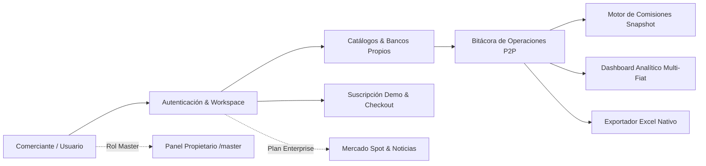
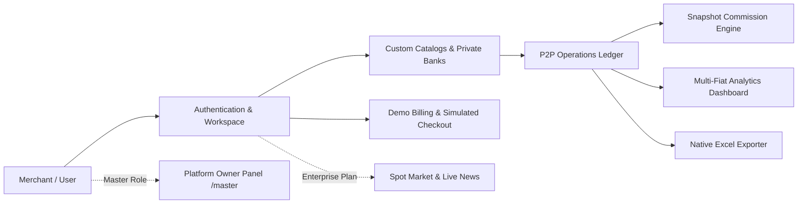
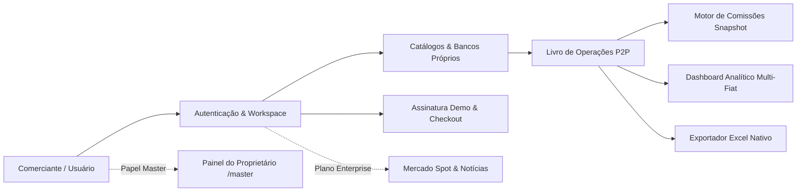

# Cyclon P2P — SaaS Platform & Analytics Journal

[](https://nextjs.org/)
[](https://react.dev/)
[](https://www.typescriptlang.org/)
[](https://tailwindcss.com/)
[](https://orm.drizzle.team/)
[](https://neon.tech/)
[](https://better-auth.com/)
[](https://deepmind.google/technologies/gemini/)

> **Idiomas disponibles / Available Languages / Idiomas disponíveis:**
> - [🇪🇸 Español](#-español)
> - [🇬🇧 English](#-english)
> - [🇧🇷 Português](#-português)

---

# 🇪🇸 Español

## 1. Visión General del Proyecto

**Cyclon P2P** es una plataforma SaaS de alto rendimiento y bitácora analítica diseñada para comerciantes de criptomonedas P2P que operan en múltiples plataformas de intercambio (Binance, Bybit, Bitget, etc.). Resuelve la fragmentación operativa, la falta de trazabilidad contable y el cálculo impreciso de comisiones multimoneda en los mercados de América Latina.

La plataforma opera bajo el modelo **Software as a Service (SaaS)** con arquitectura multinquilino (*multi-tenant*), proporcionando a cada comerciante un espacio de trabajo (*workspace*) estrictamente aislado, con gestión de métodos de pago propios, reglas de comisiones jerárquicas por país y reportes contables exportables a Excel (.xlsx).

> [!IMPORTANT]
> **Alcance de Demostración y Seguridad:**  
> Cyclon P2P es una herramienta de registro, control y analítica operativa. **No custodia fondos, no ejecuta órdenes de compra/venta ni requiere ni almacena claves privadas o API keys de los exchanges**. Todas las suscripciones comerciales y pasarelas de pago se ejecutan en modo demostración (`BILLING_MODE=demo`), etiquetando cada transacción de prueba con `is_simulated = true`.

---

## 2. ¿Cómo Funciona la Plataforma?

Cyclon P2P organiza el ciclo operativo del comerciante a través de 8 módulos interconectados:



### Módulos Principales:

1. **Autenticación y Espacios de Trabajo Aislados:**
   - Registro con nombre, correo electrónico y contraseña.
   - Creación automática e inmediata de un **Workspace privado** y asignación de un periodo de prueba gratuito (*Free Trial*) de 7 días.
   - Sesiones seguras HTTP-only y protección contra CSRF gestionadas por **Better Auth**.

2. **Catálogos Globales y Personalización Privada:**
   - Soporte nativo para 7 países de Latinoamérica: Venezuela (`VE`), Colombia (`CO`), Brasil (`BR`), Argentina (`AR`), Ecuador (`EC`), Perú (`PE`) y Chile (`CL`).
   - Gestión de 7 monedas fiat oficiales (ISO 4217): `VES`, `COP`, `BRL`, `ARS`, `USD`, `PEN` y `CLP`.
   - Criptoactivos iniciales: `USDT`, `USDC`, `BTC`, `ETH`, `SOL` y `BNB`.
   - CRUD privado e independiente de bancos y métodos de pago propios (Transferencia bancaria, Pago Móvil, Pix, PSE, Zinli, etc.), garantizando que ningún comerciante vea los métodos financieros de otro.

3. **Bitácora y CRUD de Operaciones P2P:**
   - Registro de operaciones de Compra o Venta con validación estricta de esquemas Zod en servidor.
   - Campos monetarios en alta precisión decimal (`numeric(18, 8)` para criptoactivos y `numeric(15, 2)` para fiat) para evitar errores de coma flotante binaria.
   - Desglose transparente en 3 niveles de costos:
     1. **Comisión del Comerciante:** derivada de reglas activas o sobrescrita con justificación.
     2. **Tarifa del Exchange:** tasa cobrada por la plataforma en fiat.
     3. **Cargo del Método de Pago:** costo de transferencia bancaria o pasarela.
   - **Snapshots Inmutables:** Cada operación guarda una copia fotográfica de la regla y cargos aplicados al momento del registro. Modificaciones futuras en las reglas no alteran operaciones pasadas.

4. **Dashboard y Analítica de Negocio:**
   - Métricas operativas en tiempo real: operaciones completadas vs. pendientes vs. canceladas.
   - Volumen de criptoactivos comprados y vendidos.
   - **Agregación estricta sin mezcla fiat:** Los volúmenes en fiat se agrupan estrictamente por divisa (`VES`, `COP`, `USD`, etc.). Está prohibido sumar importes de distintas monedas sin una conversión explícita.
   - Tasas promedio ponderadas por activo y dirección.

5. **Motor Determinista de Comisiones por País:**
   - Resolución de reglas por orden de prioridad jerárquica:
     $$\text{Regla} = \begin{cases} 
     \text{País + Moneda + Lado + Exchange + Método de Pago} & \text{(Prioridad 1)} \\
     \text{País + Moneda + Lado} & \text{(Prioridad 2)} \\
     \text{País + Moneda} & \text{(Prioridad 3)} \\
     \text{Sin regla (Entrada manual requerida)} & \text{(Fallback)}
     \end{cases}$$
   - Tipos de regla: Porcentaje sobre fiat, cargo fijo o híbrido (porcentaje + fijo).

6. **Generador y Exportador de Reportes Excel (.xlsx):**
   - Construcción en servidor con **ExcelJS** de libros de trabajo multicapa: *Operaciones*, *Resumen por Moneda*, *Comisiones* y *Parámetros del Reporte*.
   - Celdas con formato numérico nativo (sin cadenas concatenadas con símbolos monetarios) y códigos ISO en columnas independientes.
   - **Protección contra Inyección de Fórmulas:** Sanitización automática contra caracteres peligrosos (`=`, `+`, `-`, `@`) en descripciones, referencias o notas.

7. **Planes Comerciales y Checkout Simulado:**
   - Matriz de permisos por capacidades (`Free Trial`, `Business`, `Enterprise`).
   - Expiración de prueba controlada en servidor con **política de retención de datos**: los datos históricos y la exportación a Excel permanecen accesibles en modo lectura.
   - Pasarela `DemoBillingProvider` con cupones promocionales y selección de resultados (`approved`, `pending`, `failed`) para validación de flujos de pago.

8. **Panel Master del Propietario (`/master`):**
   - Acceso exclusivo protegido en servidor para el rol `platform_owner`.
   - Separación contable estricta: ingresos reales en $0.00 (MVP sin procesador real) diferenciados del MRR simulado de demo.
   - Directorio de clientes con inspección, suspensión y reactivación obligatoriamente justificadas.
   - Bitácora inmutable *append-only* (`platform_admin_audit_logs`) para auditoría de acciones administrativas.

9. **Módulo de Mercado y Arbitraje Enterprise (`/app/mercado`):**
   - Gráficos técnicos dinámicos en SVG basados en Klines en tiempo real de Binance (BTC, ETH, SOL, BNB).
   - Monitor de arbitraje P2P para 6 corredores de Latinoamérica.
   - Feed de noticias cripto sindicado mediante RSS en español (CriptoNoticias) sin requerir claves de API.

---

## 3. Metodología de Desarrollo

El desarrollo de Cyclon P2P se ejecutó bajo una rigurosa **Metodología de Ingeniería Guiada por Especificaciones y Fases Incrementales (*Spec-Driven & Phase-Gated Engineering*)**:

1. **Arquitectura Limpia por Capas (Clean Architecture):**
   - **Capa de Presentación (UI):** React Server Components (RSC) para velocidad de carga y Client Components exclusivamente para interactividad.
   - **Barrera de Validación y Autorización:** Esquemas Zod en todas las Server Actions y derivación estricta del `workspaceId` desde la sesión de servidor.
   - **Capa de Dominio:** Servicios desacoplados de la base de datos (`OperationsService`, `CommissionEngine`, `CatalogService`, `ExcelExportService`, `PlanService`, `MasterService`).
   - **Capa de Infraestructura y Persistencia:** Drizzle ORM sobre PostgreSQL en Neon Serverless.
2. **Seguridad por Diseño (*Security by Design*):**
   - Cero confianza en parámetros enviados por el cliente (`workspaceId` enviado por el navegador es ignorado).
   - Aislamiento multi-tenant forzado mediante cláusulas SQL obligatorias: `WHERE workspace_id = $session_workspace_id`.
   - Protección contra Formula Injection en exportaciones y XSS/CSRF en todas las capas.
3. **Control de Decisiones Arquitectónicas (ADRs):**
   - Cada decisión técnica mayor se registró formalmente en la carpeta `docs/decisions/` (desde `ADR-0001` hasta `ADR-0011`).
4. **Verificación Continua por Puertas de Salida (*Phase Exit Gates*):**
   - Ninguna fase se dio por concluida sin ejecutar y aprobar su suite de pruebas automatizadas independiente en `tests/`.

---

## 4. Plan de Ingeniería y Fases de Implementación

| Fase | Nombre | Objetivo Clave | Estado |
|---|---|---|---|
| **Fase 0** | Auditoría y Especificación | Verificación de dependencias, definición de ADRs iniciales y diseño de arquitectura. | ✅ Completada |
| **Fase 1** | Base Técnica y Sistema Visual | Next.js 16, Tailwind CSS v4, componentes accesibles con estética Cyberpunk minimalista. | ✅ Completada |
| **Fase 2** | Persistencia y Esquema Neon | Esquema Drizzle ORM, migraciones reproducibles y semillas idempotentes de datos base. | ✅ Completada |
| **Fase 3** | Autenticación y Workspaces | Better Auth, auto-aprovisionamiento de workspace y trial de 7 días, adaptador de correo. | ✅ Completada |
| **Fase 4** | Catálogos y Bancos Privados | Aislamiento multi-tenant de métodos y bancos por workspace, monedas ISO 4217. | ✅ Completada |
| **Fase 5** | CRUD de Operaciones P2P | Formularios tipados, validación Zod, precisión numérica decimal y snapshots inmutables. | ✅ Completada |
| **Fase 6** | Dashboard y Métricas Multi-Fiat | Agregaciones en servidor, tasas ponderadas y aislamiento estricto de divisas fiat. | ✅ Completada |
| **Fase 7** | Comisiones y Exportación Excel | Motor determinista jerárquico y exportador `.xlsx` multihop sanitizado. | ✅ Completada |
| **Fase 8** | Planes y Checkout Demo | Servicio de capacidades (`hasFeature`), paywall Enterprise y pasarela `DemoBillingProvider`. | ✅ Completada |
| **Fase 9** | Panel Master del Propietario | Consola `/master` para `platform_owner`, métricas globales, clientes y bitácora de auditoría. | ✅ Completada |
| **Fase 10** | Mercado y Noticias Enterprise | Klines de Binance en SVG, monitor de arbitraje LATAM y feed de noticias RSS en español. | ✅ Completada |
| **Fase 11** | QA y Suites de Pruebas | Verificación automatizada integral (`test:phase3` a `test:phase10`). | ✅ Completada |
| **Fase 12** | Despliegue y Entrega | Despliegue en Vercel, enlace con Neon Database y documentación final. | 🚀 En Despliegue |

---

## 5. El Rol de Gemini 3.8 Flash de Antigravity en el Desarrollo

La construcción completa de Cyclon P2P fue orquestada y programada utilizando el modelo **Gemini 3.8 Flash** dentro del entorno de desarrollo agéntico **Google Antigravity**.

### ¿Cómo potenció Gemini 3.8 Flash el ciclo de desarrollo?

1. **Procesamiento de Contexto Extenso a Ultra Alta Velocidad:**
   - Gemini 3.8 Flash procesó de forma continua y contextual el documento de ingeniería de más de 85 KB (`Cyclon_P2P_Plan_Ingenieria_Antigravity.md`) junto a decenas de archivos de código TypeScript sin pérdida de coherencia ni degradación en la adhesión a reglas.
2. **Adhesión Rigurosa a Reglas Arquitectónicas No Negociables:**
   - Cumplimiento inquebrantable de directrices estrictas: no mezclar divisas fiat en totales únicos, no almacenar API keys privadas, asegurar que todo `workspaceId` provenga de la sesión del servidor y forzar la marca `is_simulated = true` en toda transacción de facturación.
3. **Ejecución Agéntica Autónoma y Ciclo de Auto-Corrección:**
   - El agente no solo generó código; ejecutó comandos en la terminal (`drizzle-kit push`, `tsx scripts/...`, `tsx tests/...`), analizó los errores de compilación o fallas de red en tiempo real, e implementó patrones de resiliencia y *graceful fallbacks* automáticamente.
4. **Desarrollo Guiado por Decisiones (ADRs):**
   - Gemini 3.8 Flash documentó sistemáticamente cada paso arquitectónico en `docs/decisions/`, garantizando una trazabilidad técnica comparable a la de un equipo de ingeniería senior.
5. **Diseño Visual Cyberpunk de Primera Línea:**
   - Generación de un diseño moderno y responsivo con paleta oscura grafito (`#08090d`), contrastes verde neón (`#00ff66`), microinteracciones fluidas y componentes modulares reutilizables.

---

## 6. Guía Rápida de Instalación y Uso

### Prerrequisitos
- Node.js 20+ o 22+
- PostgreSQL (o una instancia serverless en [Neon](https://neon.tech))
- Gestor de paquetes npm

### Pasos de Instalación

```bash
# 1. Clonar el repositorio
git clone https://github.com/dannfalcon33/cyclon-p2p-saas.git
cd cyclon-p2p-saas

# 2. Instalar dependencias
npm install

# 3. Configurar variables de entorno
cp .env.example .env.local
# Configurar DATABASE_URL con la cadena de conexión de Neon

# 4. Sincronizar el esquema de base de datos
npm run db:push

# 5. Cargar datos semilla base (países, monedas, activos y planes)
npm run db:seed

# 6. (Opcional) Cargar usuarios y datos de demostración
npm run db:seed-demo

# 7. Aprovisionar usuario Master de la plataforma
npm run auth:bootstrap-owner

# 8. Iniciar el servidor de desarrollo
npm run dev
```

Abra [http://localhost:3000](http://localhost:3000) en su navegador para explorar la aplicación.

### Ejecución de Pruebas Automatizadas

```bash
npm run test:phase3   # Autenticación y Workspaces
npm run test:phase4   # Catálogos y Bancos Privados
npm run test:phase5   # CRUD de Operaciones P2P
npm run test:phase6   # Dashboard y Métricas
npm run test:phase7   # Comisiones y Exportación Excel
npm run test:phase8   # Planes y Checkout Demo
npm run test:phase9   # Panel Master del Propietario
npm run test:phase10  # Mercado y Noticias Enterprise
```

---

# 🇬🇧 English

## 1. Project Overview

**Cyclon P2P** is a high-performance SaaS platform and analytical ledger engineered for peer-to-peer (P2P) cryptocurrency merchants operating across major exchanges (Binance, Bybit, Bitget, etc.). It addresses operational fragmentation, the lack of structured bookkeeping, and inaccurate multi-currency fee calculations across Latin American markets.

Built as a multi-tenant **Software as a Service (SaaS)**, Cyclon P2P provisions each merchant an isolated private workspace, custom payment method catalogues, hierarchical country-based commission engines, and native Excel (.xlsx) financial exports.

> [!IMPORTANT]
> **Portfolio Demo Scope & Security:**  
> Cyclon P2P serves as an operational journal and analytical dashboard. **It does not custody funds, does not execute buy/sell orders on exchanges, and neither requests nor stores exchange private keys or API keys**. All subscription tiers and billing workflows operate in demonstration mode (`BILLING_MODE=demo`), explicitly marking all simulated transactions with `is_simulated = true`.

---

## 2. How the Platform Functions

Cyclon P2P structures the merchant’s workflow across 8 integrated functional pillars:



### Core Modules:

1. **Authentication & Multi-Tenant Workspaces:**
   - User registration via name, email, and password.
   - Immediate automatic provisioning of a **private Workspace** along with an automated 7-day Free Trial.
   - Secure HTTP-only cookie-based sessions with CSRF protection powered by **Better Auth**.

2. **Global Catalogs & Private Customization:**
   - Built-in support for 7 Latin American countries: Venezuela (`VE`), Colombia (`CO`), Brazil (`BR`), Argentina (`AR`), Ecuador (`EC`), Peru (`PE`), and Chile (`CL`).
   - Standardized ISO 4217 fiat currencies: `VES`, `COP`, `BRL`, `ARS`, `USD`, `PEN`, and `CLP`.
   - Core supported crypto assets: `USDT`, `USDC`, `BTC`, `ETH`, `SOL`, and `BNB`.
   - Private workspace CRUD for personal bank accounts and payment methods (Bank Transfer, Mobile Payment, Pix, PSE, Zinli, etc.), ensuring complete data isolation between merchants.

3. **P2P Operations Journal & CRUD:**
   - Buy and sell order logging protected by strict server-side Zod schemas.
   - High-precision monetary fields (`numeric(18, 8)` for crypto amounts and `numeric(15, 2)` for fiat) to prevent floating-point rounding errors.
   - Granular 3-tier fee breakdown:
     1. **Merchant Commission:** calculated from active rules or manually overridden with audit rationale.
     2. **Exchange Fee:** operational fee charged by the exchange in fiat.
     3. **Payment Method Fee:** bank transfer or provider surcharge.
   - **Immutable Rule Snapshots:** Historical operations store the exact rule and fee percentages applied at creation time; subsequent changes to commission profiles never alter past records.

4. **Analytics Dashboard & Operations Insights:**
   - Real-time operational metrics: completed vs. pending vs. canceled trades.
   - Crypto asset purchase and sale volume breakdown.
   - **Strict Zero-Cross-Currency Summation:** Fiat amounts are strictly segmented by currency (`VES`, `COP`, `USD`, etc.). Cross-currency totals without explicit foreign exchange rates are strictly prohibited.
   - Volume-weighted average exchange rates per asset and trade direction.

5. **Hierarchical Deterministic Commission Engine:**
   - Priority-based deterministic rule resolution:
     $$\text{Rule} = \begin{cases} 
     \text{Country + Currency + Side + Exchange + Payment Method} & \text{(Priority 1)} \\
     \text{Country + Currency + Side} & \text{(Priority 2)} \\
     \text{Country + Currency} & \text{(Priority 3)} \\
     \text{Unconfigured (Manual input fallback)} & \text{(Fallback)}
     \end{cases}$$
   - Supported rule models: Percentage of fiat volume, fixed flat fee, or hybrid (percentage + flat).

6. **Native Multi-Sheet Excel Exporter (.xlsx):**
   - Server-side generation using **ExcelJS** featuring 4 structured worksheets: *Operations*, *Summary by Currency*, *Commissions*, and *Report Parameters*.
   - Native numeric formatting on data cells (avoiding string-concatenated currency symbols) with ISO currency codes in dedicated columns.
   - **Formula Injection Mitigation:** Automatic escaping and sanitization of unsafe leading characters (`=`, `+`, `-`, `@`) in descriptions, references, or counterparty notes.

7. **Commercial Plans & Simulated Billing:**
   - Capability-based authorization service (`Free Trial`, `Business`, `Enterprise`).
   - Graceful trial expiration with a **data retention policy**: historical records and Excel export capabilities remain accessible in read-only mode.
   - Demo checkout interface (`DemoBillingProvider`) supporting promotional coupon codes and outcome simulation (`approved`, `pending`, `failed`).

8. **Platform Owner Master Panel (`/master`):**
   - Secure back-office console restricted to the `platform_owner` role.
   - Honest accounting separation: true platform revenue at $0.00 (portfolio MVP) distinct from estimated demo MRR.
   - Customer management table with mandatory administrative reason logs for account suspension or reinstatement.
   - Append-only immutable audit trail (`platform_admin_audit_logs`).

9. **Enterprise Market & Arbitrage Monitor (`/app/mercado`):**
   - Interactive SVG technical charts powered by live Binance Klines (BTC, ETH, SOL, BNB).
   - Real-time P2P arbitrage spread monitor for 6 Latin American currency corridors.
   - Spanish-language cryptocurrency news feed syndicated via RSS without external API key dependencies.

---

## 3. Development Methodology

Cyclon P2P was engineered following a strict **Spec-Driven & Phase-Gated Engineering Methodology**:

1. **Clean Layered Architecture:**
   - **Presentation Layer (UI):** React Server Components (RSC) for rapid initial load and Client Components reserved for interactive states.
   - **Validation & Authorization Barrier:** Server Actions validated via Zod schemas, deriving `workspaceId` exclusively from verified session tokens.
   - **Domain Services:** Modular, decoupled business logic (`OperationsService`, `CommissionEngine`, `CatalogService`, `ExcelExportService`, `PlanService`, `MasterService`).
   - **Infrastructure & Persistence:** Drizzle ORM connecting to Neon Serverless PostgreSQL.
2. **Security by Design:**
   - Zero client trust: client-supplied workspace identifiers are strictly ignored.
   - Mandatory multi-tenant query isolation: `WHERE workspace_id = $session_workspace_id`.
   - Protection against spreadsheet formula injection, XSS, and CSRF across all endpoints.
3. **Architectural Decision Records (ADRs):**
   - Every significant design choice is permanently documented in `docs/decisions/` (`ADR-0001` through `ADR-0011`).
4. **Strict Phase Exit Gates:**
   - No engineering phase was marked complete without executing and passing its dedicated automated test suite located in `tests/`.

---

## 4. Engineering Plan & Phases Breakdown

| Phase | Title | Key Objective | Status |
|---|---|---|---|
| **Phase 0** | Repository Audit & ADR Setup | Dependency audit, initial ADR documentation, architecture design. | ✅ Completed |
| **Phase 1** | Technical Foundation & Visual System | Next.js 16, Tailwind CSS v4, accessible Cyberpunk design system (`#08090d` / `#00ff66`). | ✅ Completed |
| **Phase 2** | Persistence & Neon PostgreSQL | Drizzle ORM schema, migrations, and idempotent catalog seeds. | ✅ Completed |
| **Phase 3** | Authentication & Workspaces | Better Auth setup, workspace auto-provisioning, 7-day trial, email adapter. | ✅ Completed |
| **Phase 4** | Catalogs & Private Bank CRUD | Multi-tenant isolation for banks and payment methods, ISO 4217 currencies. | ✅ Completed |
| **Phase 5** | P2P Operations CRUD | Server-validated ledger, numeric decimal precision, immutable snapshots. | ✅ Completed |
| **Phase 6** | Dashboard & Multi-Fiat Metrics | Server-side aggregations, weighted average rates, zero fiat cross-summation. | ✅ Completed |
| **Phase 7** | Commissions & Excel Exports | Deterministic hierarchical commission engine and sanitized `.xlsx` generator. | ✅ Completed |
| **Phase 8** | Commercial Plans & Demo Billing | Centralized capability checks (`hasFeature`), paywalls, and `DemoBillingProvider`. | ✅ Completed |
| **Phase 9** | Platform Owner Master Panel | Protected `/master` console, global KPIs, customer auditing, promotional coupons. | ✅ Completed |
| **Phase 10** | Enterprise Market & Live News | Binance Klines SVG charts, LATAM P2P arbitrage monitor, RSS news syndication. | ✅ Completed |
| **Phase 11** | QA & Automated Test Suites | End-to-end integration and isolation verification (`test:phase3` to `test:phase10`). | ✅ Completed |
| **Phase 12** | Production Deployment & Delivery | Vercel deployment, Neon DB linking, production owner bootstrap, documentation. | 🚀 Deploying |

---

## 5. The Role of Gemini 3.8 Flash in Google Antigravity

The entire lifecycle of Cyclon P2P was planned, implemented, and verified using **Gemini 3.8 Flash** running inside the **Google Antigravity** agentic development environment.

### Key Contributions of Gemini 3.8 Flash:

1. **Ultra-Fast Long-Context Reasoning:**
   - Gemini 3.8 Flash seamlessly digested the comprehensive 85+ KB engineering master plan (`Cyclon_P2P_Plan_Ingenieria_Antigravity.md`) alongside dozens of project source files, maintaining deep context adherence throughout multiple implementation rounds.
2. **Unyielding Adherence to Critical Constraints:**
   - The model rigorously respected non-negotiable rules: preventing cross-currency fiat mixing, forbidding the storage of exchange API keys, enforcing server-derived workspace ownership, and labeling demo billing transactions with `is_simulated = true`.
3. **Autonomous Agentic Execution & Self-Healing:**
   - Acting as a full-stack autonomous engineer, Gemini 3.8 Flash executed shell commands (`npm run build`, `drizzle-kit push`, `tsx tests/...`), evaluated compiler feedback, caught network edge cases (such as HTTP 451 geo-restrictions), and created resilient fallback handlers automatically.
4. **Systematic Architectural Documentation (ADRs):**
   - The model formulated structured ADR documents for each phase in `docs/decisions/`, capturing trade-offs, rationale, and security guarantees.
5. **High-End Cyberpunk Aesthetics:**
   - Built a sleek, futuristic dark-mode aesthetic featuring high-contrast graphite surfaces (`#08090d`), vibrant neon green accents (`#00ff66`), smooth micro-transitions, and responsive layouts.

---

## 6. Quick Start & Setup Guide

### Prerequisites
- Node.js 20+ or 22+
- PostgreSQL instance (or serverless database on [Neon](https://neon.tech))
- npm package manager

### Installation Steps

```bash
# 1. Clone repository
git clone https://github.com/dannfalcon33/cyclon-p2p-saas.git
cd cyclon-p2p-saas

# 2. Install dependencies
npm install

# 3. Configure environment variables
cp .env.example .env.local
# Set DATABASE_URL with your Neon connection string

# 4. Synchronize database schema
npm run db:push

# 5. Seed base catalogs (countries, currencies, crypto assets, plans)
npm run db:seed

# 6. (Optional) Seed demo users and realistic operations
npm run db:seed-demo

# 7. Bootstrap the platform owner account
npm run auth:bootstrap-owner

# 8. Start local development server
npm run dev
```

Navigate to [http://localhost:3000](http://localhost:3000) to view the application.

### Running Automated Test Suites

```bash
npm run test:phase3   # Authentication & Workspaces
npm run test:phase4   # Catalogs & Private Banks
npm run test:phase5   # P2P Operations CRUD
npm run test:phase6   # Dashboard & Metrics
npm run test:phase7   # Commissions & Excel Exports
npm run test:phase8   # Plans & Demo Billing
npm run test:phase9   # Platform Owner Master Panel
npm run test:phase10  # Enterprise Market & News
```

---

# 🇧🇷 Português

## 1. Visão Geral do Projeto

O **Cyclon P2P** é uma plataforma SaaS de alta performance e diário analítico projetado para comerciantes de criptomoedas P2P que operam em múltiplas exchanges (Binance, Bybit, Bitget, etc.). A plataforma soluciona a desorganização contábil, a perda de histórico financeiro e o cálculo impreciso de comissões multimoeda no mercado da América Latina.

Construído sob o modelo de **Software as a Service (SaaS)** com arquitetura multilocatária (*multi-tenant*), o Cyclon P2P fornece a cada comerciante um espaço de trabalho (*workspace*) rigorosamente isolado, gestão de métodos de pagamento próprios, motor hierárquico de comissões por país e relatórios contábeis exportáveis para Excel (.xlsx).

> [!IMPORTANT]
> **Escopo de Demonstração e Segurança:**  
> O Cyclon P2P atua como livro-razão e painel de controle analítico. **Não custodia fundos, não executa ordens de compra/venda em exchanges e não solicita nem armazena chaves privadas ou chaves de API**. Todas as assinaturas e cobranças funcionam em modo de demonstração (`BILLING_MODE=demo`), etiquetando cada transação simulada com `is_simulated = true`.

---

## 2. Como a Plataforma Funciona?

O Cyclon P2P estrutura a rotina do comerciante através de 8 pilares operacionais interligados:



### Principais Módulos:

1. **Autenticação e Espaços de Trabalho Isolados:**
   - Cadastro com nome, e-mail e senha.
   - Criação automática e imediata de um **Workspace privado** com atribuição de 7 dias de avaliação gratuita (*Free Trial*).
   - Sessões seguras HTTP-only e proteção contra ataques CSRF através do **Better Auth**.

2. **Catálogos Globais e Configuração Privada:**
   - Suporte nativo a 7 países da América Latina: Venezuela (`VE`), Colômbia (`CO`), Brasil (`BR`), Argentina (`AR`), Equador (`EC`), Peru (`PE`) e Chile (`CL`).
   - Moedas fiduciárias padronizadas (ISO 4217): `VES`, `COP`, `BRL`, `ARS`, `USD`, `PEN` e `CLP`.
   - Criptoativos suportados: `USDT`, `USDC`, `BTC`, `ETH`, `SOL` e `BNB`.
   - CRUD privado e independente para bancos e métodos de pagamento próprios (Transferência bancária, Pix, TED, Boleto, Zinli, etc.), garantindo sigilo absoluto entre comerciantes.

3. **Livro e CRUD de Operações P2P:**
   - Registro de operações de Compra ou Venda validado no servidor com esquemas Zod.
   - Campos monetários com alta precisão decimal (`numeric(18, 8)` para cripto e `numeric(15, 2)` para fiat) para eliminar falhas de ponto flutuante binário.
   - Discriminação transparente de custos em 3 níveis:
     1. **Comissão do Comerciante:** calculada automaticamente ou ajustada com justificativa.
     2. **Tarifa da Exchange:** taxa cobrada pela plataforma de negociação em fiat.
     3. **Custo do Método de Pagamento:** taxas bancárias ou da instituição financeira.
   - **Snapshots Imutáveis:** Cada operação armazena os parâmetros exatos da regra aplicada no momento da criação; alterações futuras nas tabelas de comissão não afetam registros históricos.

4. **Dashboard e Métricas Operacionais:**
   - Indicadores operacionais em tempo real: operações concluídas vs. pendentes vs. canceladas.
   - Volume de compra e venda por criptoativo.
   - **Agregação estrita sem mistura de moedas:** Volumes em fiat são estritamente agrupados por moeda (`BRL`, `USD`, `ARS`, etc.). É proibido somar moedas diferentes sem conversão explícita de câmbio.
   - Taxas de câmbio médias ponderadas por ativo e sentido de negociação.

5. **Motor Hierárquico Determinístico de Comissões:**
   - Resolução hierárquica por prioridade:
     $$\text{Regra} = \begin{cases} 
     \text{País + Moeda + Lado + Exchange + Método de Pagamento} & \text{(Prioridade 1)} \\
     \text{País + Moeda + Lado} & \text{(Prioridade 2)} \\
     \text{País + Moeda} & \text{(Prioridade 3)} \\
     \text{Sem regra configurada (Entrada manual obrigatória)} & \text{(Fallback)}
     \end{cases}$$
   - Modelos de regra: Percentual sobre o volume fiat, valor fixo ou híbrido (percentual + fixo).

6. **Gerador e Exportador de Relatórios Excel (.xlsx):**
   - Criação no servidor com **ExcelJS** de planilhas estruturadas: *Operações*, *Resumo por Moeda*, *Comissões* e *Parâmetros do Relatório*.
   - Células com formato numérico nativo (sem strings com símbolos de moeda misturados) e códigos ISO em colunas exclusivas.
   - **Prevenção contra Injeção de Fórmulas:** Sanitização de caracteres perigosos (`=`, `+`, `-`, `@`) em descrições, notas ou referências.

7. **Planos Comerciais e Checkout Simulado:**
   - Controle centralizado de recursos (`Free Trial`, `Business`, `Enterprise`).
   - Expiração do período de teste com **política de retenção de dados**: consulta de dados e exportação para Excel permanecem liberadas em modo de leitura.
   - Checkout de demonstração (`DemoBillingProvider`) com cupons promocionais e simulação de status (`approved`, `pending`, `failed`).

8. **Painel Master do Proprietário (`/master`):**
   - Acesso exclusivo protegido no servidor para o perfil `platform_owner`.
   - Separação contábil estrita: faturamento real em R$ 0,00 (MVP de demonstração) claramente diferenciado do MRR estimado de demo.
   - Gerenciamento de clientes com registro obrigatório de justificativa para suspensões ou reativações.
   - Histórico de auditoria imutável *append-only* (`platform_admin_audit_logs`).

9. **Módulo Enterprise de Mercado e Arbitragem (`/app/mercado`):**
   - Gráficos técnicos interativos em SVG com Klines em tempo real da Binance (BTC, ETH, SOL, BNB).
   - Monitor de arbitragem P2P para 6 mercados da América Latina.
   - Feed de notícias cripto via RSS sem necessidade de chaves de API pagas.

---

## 3. Metodologia de Desenvolvimento

O desenvolvimento do Cyclon P2P foi conduzido sob uma **Metodologia de Engenharia Orientada a Especificações e Fases com Portas de Saída (*Spec-Driven & Phase-Gated Engineering*)**:

1. **Arquitetura Limpa em Camadas (Clean Architecture):**
   - **Camada de Apresentação (UI):** React Server Components (RSC) para carregamento veloz e Client Components estritamente para interatividade.
   - **Barreira de Validação e Autorização:** Schemas Zod em todas as Server Actions e derivação do `workspaceId` exclusivamente a partir do token de sessão validado no servidor.
   - **Camada de Domínio:** Serviços desacoplados da persistência direta (`OperationsService`, `CommissionEngine`, `CatalogService`, `ExcelExportService`, `PlanService`, `MasterService`).
   - **Camada de Infraestrutura:** Drizzle ORM sobre PostgreSQL Serverless no Neon.
2. **Segurança por Padrão (*Security by Design*):**
   - Confiança zero no cliente: identificadores de workspace enviados pelo navegador são ignorados.
   - Isolamento multi-tenant forçado por cláusulas SQL: `WHERE workspace_id = $session_workspace_id`.
   - Sanitização de fórmulas em exportações e proteção CSRF/XSS em todas as requisições.
3. **Registro de Decisões de Arquitetura (ADRs):**
   - Todas as decisões estruturais foram documentadas formalmente em `docs/decisions/` (de `ADR-0001` a `ADR-0011`).
4. **Validação Contínua por Portas de Saída:**
   - Nenhuma fase foi concluída sem a execução e aprovação de sua suíte automatizada de testes em `tests/`.

---

## 4. Plano de Engenharia e Detalhamento de Fases

| Fase | Título | Objetivo Principal | Estado |
|---|---|---|---|
| **Fase 0** | Auditoria e Especificação | Auditoria de dependências, documentação de ADRs e arquitetura base. | ✅ Concluída |
| **Fase 1** | Base Técnica e Design System | Next.js 16, Tailwind CSS v4, componentes Cyberpunk minimalistas (`#08090d` / `#00ff66`). | ✅ Concluída |
| **Fase 2** | Persistência e Esquema Neon | Esquema Drizzle ORM, migrações seguras e sementes idempotentes de dados base. | ✅ Concluída |
| **Fase 3** | Autenticação e Workspaces | Better Auth, criação automática de workspace, trial de 7 dias e adaptador de e-mail. | ✅ Concluída |
| **Fase 4** | Catálogos e Bancos Próprios | Isolamento multi-tenant de bancos e métodos de pagamento, moedas ISO 4217. | ✅ Concluída |
| **Fase 5** | CRUD de Operações P2P | Validação Zod no servidor, precisão decimal e snapshots imutáveis de regras. | ✅ Concluída |
| **Fase 6** | Dashboard e Métricas Multi-Fiat | Agregações no servidor, taxas médias ponderadas e isolamento estrito de fiduciárias. | ✅ Concluída |
| **Fase 7** | Comissões e Exportação Excel | Motor determinístico de comissões e exportador `.xlsx` com proteção contra injeção. | ✅ Concluída |
| **Fase 8** | Planos e Checkout Demo | Verificação centralizada de recursos (`hasFeature`), paywalls e `DemoBillingProvider`. | ✅ Concluída |
| **Fase 9** | Painel Master do Proprietário | Console `/master` para `platform_owner`, métricas globais, auditoria e clientes. | ✅ Concluída |
| **Fase 10** | Mercado e Notícias Enterprise | Klines da Binance em SVG, monitor de arbitragem LATAM e notícias cripto via RSS. | ✅ Concluída |
| **Fase 11** | QA e Suíte de Testes | Verificação automatizada de isolamento e regras de negócio (`test:phase3` a `test:phase10`). | ✅ Concluída |
| **Fase 12** | Deploy e Entrega Final | Publicação na Vercel, integração com Neon DB e documentação definitiva. | 🚀 Em Deploy |

---

## 5. O Papel do Gemini 3.8 Flash no Google Antigravity

A construção integral do Cyclon P2P foi projetada, programada e validada utilizando o modelo **Gemini 3.8 Flash** dentro do ecossistema agêntico **Google Antigravity**.

### Como o Gemini 3.8 Flash transformou o ciclo de desenvolvimento?

1. **Raciocínio com Contexto Extenso e Alta Velocidade:**
   - O Gemini 3.8 Flash processou de ponta a ponta o documento mestre de engenharia com mais de 85 KB (`Cyclon_P2P_Plan_Ingenieria_Antigravity.md`) e dezenas de arquivos do projeto em TypeScript, mantendo consistência lógica sem perda de diretrizes.
2. **Obediência Incondicional a Regras Críticas:**
   - Rigor na aplicação das regras de negócio: proibição de soma cruzada de moedas fiat, proibição de requisição ou armazenamento de API keys de exchanges, isolamento obrigatório de workspaces e marcação explícita de simulação em transações de checkout.
3. **Execução Agêntica Autônoma e Resolução de Problemas:**
   - O modelo atuou de maneira autônoma no terminal (`npm run build`, `drizzle-kit push`, `tsx tests/...`), interpretou saídas de erro em tempo real, tratou bloqueios de rede com elegância (como status HTTP 451) e gerou rotinas de contingência instantaneamente.
4. **Documentação Arquitetural Sistemática (ADRs):**
   - Criação metódica de relatórios ADR em `docs/decisions/` registrando vantagens, desvantagens e garantias de segurança para cada decisão relevante.
5. **Estética Cyberpunk Sofisticada:**
   - Criação de uma interface futurista refinada com fundo grafite escuro (`#08090d`), destaques em verde neon (`#00ff66`), contraste com acessibilidade e microinterações fluidas.

---

## 6. Guia Rápido de Instalação e Execução

### Pré-requisitos
- Node.js 20+ ou 22+
- Instância PostgreSQL (ou banco serverless no [Neon](https://neon.tech))
- Gerenciador de pacotes npm

### Passos de Instalação

```bash
# 1. Clonar o repositório
git clone https://github.com/dannfalcon33/cyclon-p2p-saas.git
cd cyclon-p2p-saas

# 2. Instalar dependências
npm install

# 3. Configurar variáveis de ambiente
cp .env.example .env.local
# Defina DATABASE_URL com a URL de conexão do Neon

# 4. Sincronizar o esquema do banco de dados
npm run db:push

# 5. Popular catálogos base (países, moedas, ativos e planos)
npm run db:seed

# 6. (Opcional) Popular usuários e dados de teste
npm run db:seed-demo

# 7. Criar a conta Master do proprietário
npm run auth:bootstrap-owner

# 8. Iniciar o servidor de desenvolvimento
npm run dev
```

Abra [http://localhost:3000](http://localhost:3000) no seu navegador para utilizar o sistema.

### Execução dos Testes Automatizados

```bash
npm run test:phase3   # Autenticação e Workspaces
npm run test:phase4   # Catálogos e Bancos Próprios
npm run test:phase5   # CRUD de Operações P2P
npm run test:phase6   # Dashboard e Métricas
npm run test:phase7   # Comissões e Exportação Excel
npm run test:phase8   # Planos e Checkout Demo
npm run test:phase9   # Painel Master do Proprietário
npm run test:phase10  # Mercado e Notícias Enterprise
```

---

<p align="center">
  <b>Cyclon P2P</b> — Engineered with precision by <b>Google DeepMind's Antigravity</b> powered by <b>Gemini 3.8 Flash</b>.
</p>
