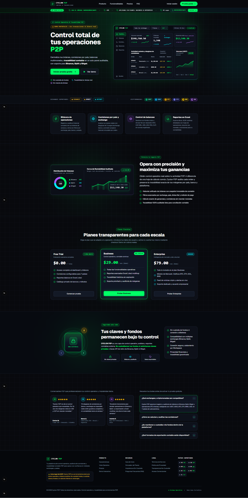
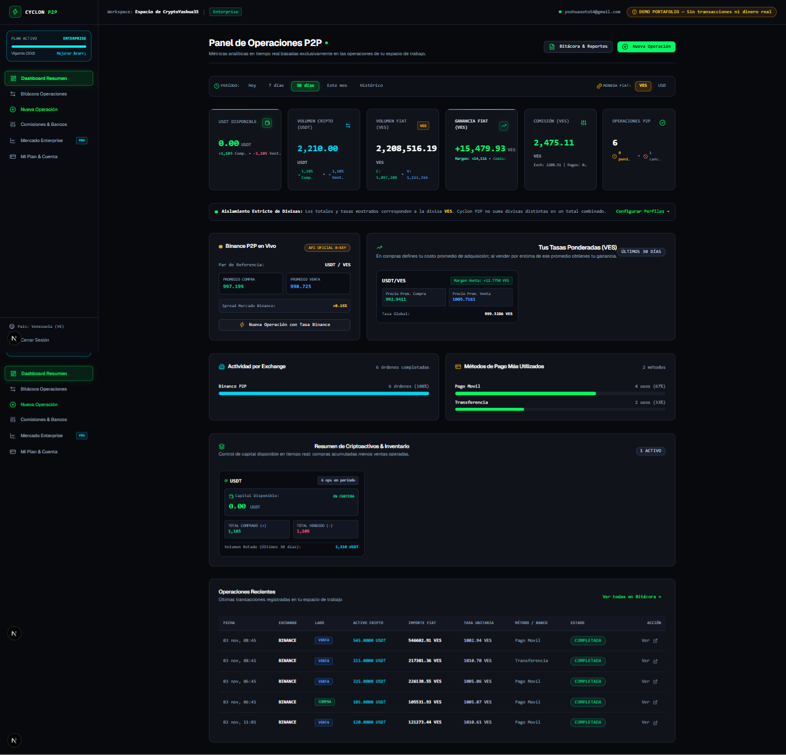
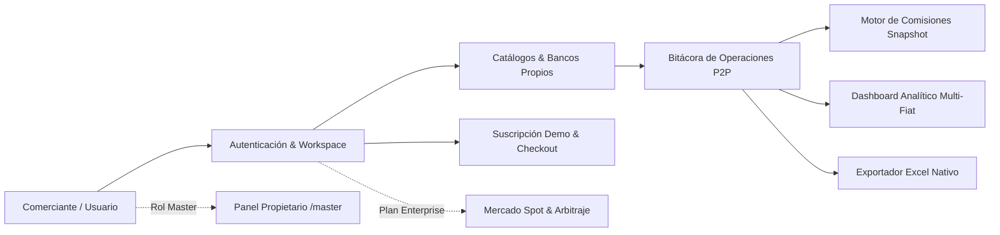

# Cyclon P2P — SaaS Platform, Multi-Fiat Ledger & P2P Analytics

[](https://nextjs.org/)
[](https://react.dev/)
[](https://www.typescriptlang.org/)
[](https://tailwindcss.com/)
[](https://www.framer.com/motion/)
[](https://orm.drizzle.team/)
[](https://neon.tech/)
[](https://better-auth.com/)
[](https://deepmind.google/technologies/gemini/)

> **Idiomas disponibles / Available Languages / Idiomas disponíveis:**
> - [🇪🇸 Español](#-español)
> - [🇬🇧 English](#-english)
> - [🇧🇷 Português](#-português)

---

## 🖼️ Vista Previa de la Plataforma / Platform Visual Showcase

| 🌐 Landing Page & Control Operativo (`screenshot.png`) | 📊 Dashboard Analítico del Comerciante (`dashboard.png`) |
| :---: | :---: |
|  |  |
| *Landing page interactiva con cintillo de promociones en vivo, mockup operativo en el Hero, curva de rentabilidad auditada, planes con checkout demo integrado y arquitectura sin custodia.* | *Panel de operaciones P2P en tiempo real con control de inventario cripto, aislamiento estricto por divisa fiat, ganancia realizada sobre costo promedio de compra y benchmark Binance P2P 0-Key.* |

---

# 🇪🇸 Español

## 1. Visión General del Proyecto

**Cyclon P2P** es una plataforma SaaS de alto rendimiento y bitácora analítica diseñada para comerciantes profesionales de criptomonedas P2P que operan en múltiples plataformas de intercambio (**Binance P2P, Bybit P2P, Bitget P2P**). Resuelve la fragmentación operativa, la falta de trazabilidad contable y el cálculo impreciso de márgenes y comisiones multimoneda en los mercados de América Latina.

La plataforma opera bajo el modelo **Software as a Service (SaaS)** con arquitectura multinquilino (*multi-tenant*), proporcionando a cada comerciante un espacio de trabajo (*workspace*) estrictamente aislado, con control de inventario cripto en tiempo real, cálculo exacto de ganancias realizadas sobre el precio promedio de compra, gestión de métodos de pago y bancos propios, reglas de comisiones jerárquicas por país y reportes contables exportables a Excel (`.xlsx`).

> [!IMPORTANT]
> **Alcance de Demostración y Seguridad Sin Custodia (Non-Custodial):**  
> Cyclon P2P es una herramienta externa de registro, control operativo y auditoría contable. **No custodia fondos, no ejecuta órdenes de compra/venta ni solicita o almacena claves privadas ni API keys de retiro de los exchanges**. Todas las suscripciones comerciales y pasarelas de pago se ejecutan en modo demostración (`BILLING_MODE=demo`), etiquetando cada transacción de prueba con `is_simulated = true`.

---

## 2. Recorrido Visual Detallado de la Aplicación

### 2.1. Landing Page Comercial e Interactiva (`./screenshot.png`)


La página principal de **Cyclon P2P** fue diseñada bajo una estética **Cyberpunk Financiera** (`#08090d` con acentos verde neón `#00ff66`, cyan `#00f0ff` y violeta `#8b5cf6`) animada con **Framer Motion** y centrada en vender **control operativo y trazabilidad contable**:

1. **Cintillo de Carrusel de Promociones en Vivo (`PromoCarouselBanner`):**
   - Ubicado inmediatamente debajo del encabezado (`Navbar`), exhibe en un carrusel continuo la promoción activa configurada desde el Panel Master (p. ej. `NUEVOCOMERCIANTE — 25% OFF`).
   - El sistema garantiza **exclusividad de una sola promoción activa a la vez**: al activar un cupón en `/master/promociones`, cualquier otro cupón se pausa automáticamente.
   - Permite copiar el código en un clic o pulsar **`Canjear`**, abriendo directamente el modal de registro y checkout con el descuento ya aplicado.
2. **Hero con Dashboard Operativo Realista:**
   - Presenta una vista en vivo del producto con métricas de volumen operado en USDT, órdenes trazadas en múltiples exchanges, ganancia neta post-comisión, tabla de actividad reciente con *Snapshot Inmutable* y curva de crecimiento mensual.
3. **Barra de Compatibilidad Multi-Exchange y Multi-Activo:**
   - Integración operativa para **Binance, Bybit y Bitget**, soportando los criptoactivos de mayor liquidez (`USDT`, `USDC`, `BTC`, `ETH`, `BNB`, `SOL`).
4. **Cuatro Bloques de Beneficios Clave & Vista Operativa:**
   - Explica el flujo de **Bitácora de operaciones**, **Comisiones por país y exchange**, **Control de balances sin mezcla fiat** y **Reportes en Excel (.xlsx)**, acompañado de gráficos animados de distribución de volumen y curva de rentabilidad auditada.
5. **Planes Comerciales con Registro y Checkout Demo Integrado (`PlanCheckoutModal`):**
   - Tarjetas para **Free Trial ($0 / 7 días)**, **Business ($29 / mes — Más Popular)** y **Enterprise ($79 / mes)**.
   - Al elegir cualquier plan desde la Landing Page o `/precios`, se despliega un flujo completo que registra la cuenta del comerciante, crea su Workspace aislado y procesa el checkout simulado en un solo paso.
6. **Seguridad Sin Custodia, Testimonios, FAQ Interactiva y Footer Multipaís:**
   - Detalla las garantías de privacidad financiera y los 7 países latinoamericanos soportados con sus respectivas banderas y códigos ISO (`VE/VES`, `CO/COP`, `BR/BRL`, `AR/ARS`, `EC/USD`, `PE/PEN`, `CL/CLP`).

---

### 2.2. Dashboard Analítico del Comerciante P2P (`./dashboard.png`)


El **Panel de Operaciones P2P (`/app`)** centraliza toda la inteligencia contable y de inventario del comerciante en tiempo real:

1. **6 Tarjetas KPI de Alta Precisión:**
   - **USDT Disponible (Inventario en Cartera):** Muestra el capital cripto disponible en tiempo real calculado como `Capital Inicial + Compras Acumuladas - Ventas Operadas` (p. ej. `+1,105 Comp. • -1,105 Vent.`). Impide registrar ventas si no existe inventario suficiente.
   - **Volumen Cripto (`USDT`):** Suma total de unidades cripto movilizadas en el período seleccionado, desglosadas entre compras (*Inflow*) y ventas (*Outflow*).
   - **Volumen Fiat Aislado (`VES`, `USD`, etc.):** Total operado exclusivamente en la divisa fiat seleccionada (`C: Compras • V: Ventas`), respetando la regla de **cero mezcla de monedas**.
   - **Ganancia Fiat Realizada (Sobre Precio Promedio de Compra):**
     - Implementa la lógica contable real del comercio P2P: **en las compras (`COMPRA`) se adquiere el activo cripto para el inventario sin generar ganancia (`0.00`)**, estableciendo el **Precio Promedio Ponderado de Compra**.
     - **Las ganancias se realizan exclusivamente en las ventas (`VENTA`)**, calculando el margen obtenido sobre el costo promedio de adquisición:
       $$\text{Ganancia Realizada} = \text{Cantidad Vendida} \times (\text{Precio Promedio de Venta} - \text{Precio Promedio de Compra}) + \text{Comisiones Netas de Venta}$$
   - **Comisión y Costos Operativos:** Desglose transparente entre comisión del comerciante, tarifa del exchange (`Exch`) y cargos de métodos de pago (`Pagos`).
   - **Contador de Operaciones P2P:** Órdenes completadas, pendientes y canceladas en el período.
2. **Benchmark Binance P2P en Vivo (API Oficial 0-Key) & Tasas Ponderadas:**
   - Consulta en tiempo real el libro de órdenes de **Binance P2P** para el par activo (`USDT/VES`, `USDT/COP`, etc.), mostrando el promedio de compra, promedio de venta y *spread* del mercado sin requerir API Keys.
   - Compara lado a lado el mercado con **Tus Tasas Ponderadas**: `Precio Prom. Compra`, `Precio Prom. Venta`, `Margen Venta` por unidad y `Tasa Global`.
3. **Distribución por Exchange, Métodos de Pago e Inventario:**
   - Barras de progreso con la participación porcentual por exchange (`Binance P2P`, `Bybit P2P`, `Bitget P2P`) y por método de pago (`Pago Móvil`, `Transferencia`, `Zelle`, `Pix`, etc.).
   - Tarjeta detallada de **Resumen de Criptoactivos & Inventario** y tabla de **Operaciones Recientes** con acceso directo al expediente inmutable de cada orden.
4. **Experiencia de Usuario (UX) Segura y Fluida:**
   - **Indicador Central de Carga (`PageLoadingProvider`):** Círculo giratorio verde neón y barra de progreso centrada que informa al usuario mientras navega entre módulos, filtra métricas o registra una operación en Neon PostgreSQL.
   - **Modal de Confirmación de Cierre de Sesión:** Tanto en el panel del comerciante (`/app`) como en el panel Master (`/master`), el botón *Cerrar Sesión* solicita confirmación expresa antes de finalizar la sesión activa.

---

## 3. Arquitectura Funcional de la Plataforma

Cyclon P2P organiza el ciclo operativo del comerciante a través de 9 módulos interconectados:



### Módulos Principales:

1. **Autenticación, Registro con Checkout y Espacios de Trabajo Aislados:**
   - Registro directo desde `/registro`, la Landing Page (`/`) o `/precios` con selección de plan (`Free Trial`, `Business`, `Enterprise`) y aplicación de cupones promocionales.
   - Creación automática e inmediata de un **Workspace privado** con aislamiento multinquilino estricto.
   - Sesiones seguras HTTP-only y protección contra CSRF gestionadas por **Better Auth**.

2. **Catálogos Globales y Personalización Privada (`/app/configuracion`):**
   - Soporte nativo para 7 países de Latinoamérica: Venezuela (`VE`), Colombia (`CO`), Brasil (`BR`), Argentina (`AR`), Ecuador (`EC`), Perú (`PE`) y Chile (`CL`).
   - Gestión de 7 monedas fiat oficiales (ISO 4217): `VES`, `COP`, `BRL`, `ARS`, `USD`, `PEN` y `CLP`.
   - Criptoactivos soportados: `USDT`, `USDC`, `BTC`, `ETH`, `SOL` y `BNB`.
   - Configuración de **Saldos Iniciales de Capital (Cripto y Fiat)** y CRUD privado de bancos y métodos de pago propios.

3. **Bitácora Inteligente y CRUD de Operaciones P2P (`/app/operaciones` y `/app/operaciones/nueva`):**
   - Validación estricta de saldos disponibles antes de operar: bloquea compras sin saldo fiat suficiente y bloquea ventas sin inventario cripto disponible.
   - Cotizaciones en vivo de **Binance P2P y Bybit P2P** integradas en el formulario para aplicar tasas de mercado en un clic.
   - Calculador interactivo de **Margen de Venta / Sobrante** en órdenes de venta tomando como costo base el **Precio Promedio Ponderado de Compra** del inventario.
   - Alta precisión decimal (`numeric(18, 8)` para criptoactivos y `numeric(15, 2)` para fiat) y **Snapshots Inmutables** de reglas de comisión.

4. **Motor Determinista de Comisiones por País:**
   - Resolución de reglas por orden de prioridad jerárquica:
     $$\text{Regla} = \begin{cases} 
     \text{País + Moneda + Lado + Exchange + Método de Pago} & \text{(Prioridad 1)} \\
     \text{País + Moneda + Lado} & \text{(Prioridad 2)} \\
     \text{País + Moneda} & \text{(Prioridad 3)} \\
     \text{Sin regla (Entrada manual / 0\%)} & \text{(Fallback)}
     \end{cases}$$

5. **Generador y Exportador de Reportes Excel (`.xlsx`):**
   - Construcción en servidor con **ExcelJS** de libros de trabajo multicapa: *Operaciones*, *Resumen por Moneda*, *Comisiones* y *Parámetros del Reporte*.
   - Celdas con formato numérico nativo y sanitización automática contra **Inyección de Fórmulas** (`=`, `+`, `-`, `@`).

6. **Panel Master del Propietario (`/master`):**
   - Acceso exclusivo protegido en servidor para el rol `platform_owner`.
   - **Gestión de Promociones y Cintillo de Landing (`/master/promociones`):** Creación y activación de cupones de descuento con vista previa en vivo del cintillo de carrusel de la Landing Page (garantizando que solo una promoción pueda estar activa a la vez).
   - Directorio de clientes SaaS (`/master/clientes`) con suspensión/reactivación auditada y bitácora inmutable *append-only* (`/master/auditoria`).

7. **Módulo de Mercado y Arbitraje Enterprise (`/app/mercado`):**
   - Gráficos técnicos dinámicos en SVG basados en Klines en tiempo real de Binance (`BTC`, `ETH`, `SOL`, `BNB`).
   - Comparador multi-exchange P2P y Spot (`Binance`, `Bybit`, `Bitget`) y monitor de arbitraje para 6 corredores de Latinoamérica, más feed de noticias cripto vía RSS en español.

---

## 4. Metodología de Desarrollo y Plan de Ingeniería

El desarrollo de Cyclon P2P se ejecutó bajo una rigurosa **Metodología de Ingeniería Guiada por Especificaciones y Fases Incrementales (*Spec-Driven & Phase-Gated Engineering*)**:

| Fase | Nombre | Objetivo Clave | Estado |
|---|---|---|---|
| **Fase 0** | Auditoría y Especificación | Verificación de dependencias, definición de ADRs iniciales y diseño de arquitectura. | ✅ Completada |
| **Fase 1** | Base Técnica y Sistema Visual | Next.js 16, Tailwind CSS v4, componentes accesibles y Landing con Framer Motion. | ✅ Completada |
| **Fase 2** | Persistencia y Esquema Neon | Esquema Drizzle ORM, migraciones reproducibles y semillas idempotentes de datos base. | ✅ Completada |
| **Fase 3** | Autenticación y Workspaces | Better Auth, auto-aprovisionamiento de workspace, trial de 7 días y confirmación de logout. | ✅ Completada |
| **Fase 4** | Catálogos y Bancos Privados | Aislamiento multi-tenant de métodos, bancos y saldos iniciales por workspace. | ✅ Completada |
| **Fase 5** | CRUD de Operaciones P2P | Validación de inventario, tasas en vivo, cálculo de margen sobre costo promedio y snapshots. | ✅ Completada |
| **Fase 6** | Dashboard y Métricas Multi-Fiat | Ganancias realizadas en ventas, tasas ponderadas y aislamiento estricto de divisas fiat. | ✅ Completada |
| **Fase 7** | Comisiones y Exportación Excel | Motor determinista jerárquico y exportador `.xlsx` multicapa sanitizado. | ✅ Completada |
| **Fase 8** | Planes y Checkout Demo | Servicio de capacidades (`hasFeature`), registro con checkout demo y `DemoBillingProvider`. | ✅ Completada |
| **Fase 9** | Panel Master y Cintillo Promo | Consola `/master`, control exclusivo del cintillo promocional en Landing y auditoría. | ✅ Completada |
| **Fase 10** | Mercado y Noticias Enterprise | Klines de Binance en SVG, monitor de arbitraje LATAM y feed de noticias RSS en español. | ✅ Completada |
| **Fase 11** | QA y Suites de Pruebas | Verificación automatizada integral (`test:phase3` a `test:phase10`). | ✅ Completada |
| **Fase 12** | Despliegue y Entrega | Despliegue en producción, enlace con Neon Database y documentación final. | ✅ Completada |

---

## 5. Guía Rápida de Instalación y Uso

### Prerrequisitos
- Node.js 20+ o 22+
- PostgreSQL (o una instancia serverless en [Neon](https://neon.tech))
- Gestor de paquetes `npm`

### Pasos de Instalación

```bash
# 1. Clonar el repositorio
git clone https://github.com/dannfalcon33/cyclon-p2p-saas.git
cd cyclon-p2p-saas

# 2. Instalar dependencias
npm install

# 3. Configurar variables de entorno
cp .env.example .env.local
# Configurar DATABASE_URL con la cadena de conexión de Neon PostgreSQL

# 4. Sincronizar el esquema de base de datos
npm run db:push

# 5. Cargar datos semilla base (países, monedas, activos, planes y promociones)
npm run db:seed

# 6. (Opcional) Cargar usuarios y operaciones de demostración
npm run db:seed-demo

# 7. Aprovisionar usuario Master de la plataforma
npm run auth:bootstrap-owner

# 8. Iniciar el servidor de desarrollo
npm run dev
```

Abra [http://localhost:3000](http://localhost:3000) en su navegador para explorar la aplicación.

### Ejecución de Pruebas Automatizadas

```bash
npm run test:phase3   # Autenticación y Workspaces
npm run test:phase4   # Catálogos y Bancos Privados
npm run test:phase5   # CRUD de Operaciones P2P
npm run test:phase6   # Dashboard y Métricas
npm run test:phase7   # Comisiones y Exportación Excel
npm run test:phase8   # Planes y Checkout Demo
npm run test:phase9   # Panel Master del Propietario
npm run test:phase10  # Mercado y Noticias Enterprise
```

---

# 🇬🇧 English

## 1. Project Overview

**Cyclon P2P** is a high-performance SaaS platform and analytical ledger engineered for peer-to-peer (P2P) cryptocurrency merchants operating across major exchanges (**Binance P2P, Bybit P2P, Bitget P2P**). It solves operational fragmentation, lack of auditable bookkeeping, and inaccurate multi-currency margin and fee calculations across Latin American markets.

Built as a multi-tenant **Software as a Service (SaaS)**, Cyclon P2P provisions each merchant an isolated private workspace with real-time crypto inventory tracking, realized profit calculation based on weighted average purchase cost, private bank and payment method catalogues, hierarchical country-based commission rules, and native Excel (`.xlsx`) financial exports.

> [!IMPORTANT]
> **Portfolio Demo Scope & Non-Custodial Security:**  
> Cyclon P2P serves as an external operational journal and analytical dashboard. **It does not custody funds, does not execute buy/sell orders on exchanges, and neither requests nor stores exchange private keys or withdrawal API keys**. All subscription tiers and billing workflows operate in demonstration mode (`BILLING_MODE=demo`), explicitly marking all simulated transactions with `is_simulated = true`.

---

## 2. Detailed Visual Walkthrough

### 2.1. Interactive Commercial Landing Page (`./screenshot.png`)


1. **Live Promotional Carousel Banner (`PromoCarouselBanner`):**
   - Positioned directly below the navigation header, displaying an animated marquee with the currently active promotional coupon managed from `/master/promociones`.
   - Enforces **strict single-active-promotion exclusivity**: activating a coupon in the Master Panel automatically pauses all others. Includes 1-click coupon copy and direct redemption inside `PlanCheckoutModal`.
2. **Realistic Hero Operational Dashboard & Animated Sections:**
   - Powered by **Framer Motion**, showcasing live-style P2P metrics, multi-exchange compatibility (**Binance, Bybit, Bitget** + `USDT`, `USDC`, `BTC`, `ETH`, `BNB`, `SOL`), audited profitability curves, non-custodial security architecture, and direct registration + simulated checkout from any pricing tier (`Free Trial`, `Business`, `Enterprise`).

### 2.2. Merchant P2P Analytics Dashboard (`./dashboard.png`)


1. **6 Real-Time Operational KPI Cards:**
   - **Available USDT (Wallet Inventory):** Tracks real-time available crypto capital (`Initial Capital + Cumulative Purchases - Completed Sales`), preventing sales when inventory is insufficient.
   - **Crypto Volume & Strictly Isolated Fiat Volume:** Displays crypto inflow/outflow and fiat volume strictly isolated by currency (`VES`, `USD`, `COP`, `BRL`, `ARS`, `PEN`, `CLP`) with zero cross-currency mixing.
   - **Realized Fiat Profit (Margin Above Weighted Average Purchase Cost):**
     - Reflects true P2P trading accounting: **purchases (`BUY`) acquire the crypto asset into inventory and establish your Weighted Average Purchase Price (`0.00` realized profit on buys)**.
     - **Profits are realized exclusively on sales (`SELL`)** by comparing the selling price against the weighted average purchase cost:
       $$\text{Realized Profit} = \text{Sold Quantity} \times (\text{Avg Sell Rate} - \text{Avg Buy Cost}) + \text{Net Sale Fees}$$
   - **Commissions & P2P Order Counters:** Full breakdown of exchange fees, payment method charges, and completed/pending/cancelled order counts.
2. **Live 0-Key Binance P2P Benchmark & Weighted Rates:**
   - Fetches real-time buy/sell averages and market spread directly from Binance P2P order books without API keys, alongside your workspace's weighted average buy price, sell price, and unit margin.
3. **Smooth UX with Centered Loading Indicator & Logout Confirmation Modal:**
   - Displays a centered neon-green spinner and progress bar (`PageLoadingProvider`) during route transitions, filter updates, and operation registration, plus a confirmation modal (`Dialog`) before logging out of either `/app` or `/master`.

---

## 3. Quick Start & Setup Guide

```bash
# 1. Clone repository & install dependencies
git clone https://github.com/dannfalcon33/cyclon-p2p-saas.git
cd cyclon-p2p-saas
npm install

# 2. Configure environment variables (.env.local) & push schema to Neon PostgreSQL
cp .env.example .env.local
npm run db:push

# 3. Seed base catalogs, demo data, and platform owner
npm run db:seed
npm run db:seed-demo
npm run auth:bootstrap-owner

# 4. Start development server
npm run dev
```

---

# 🇧🇷 Português

## 1. Visão Geral do Projeto

O **Cyclon P2P** é uma plataforma SaaS de alta performance e diário analítico projetado para comerciantes de criptomoedas P2P que operam em múltiplas exchanges (**Binance P2P, Bybit P2P, Bitget P2P**). A plataforma soluciona a fragmentação operacional, a falta de rastreabilidade contábil e o cálculo impreciso de margens e comissões multimoeda nos mercados da América Latina.

Construído sob o modelo **Software as a Service (SaaS)** com arquitetura multilocatária (*multi-tenant*), o Cyclon P2P fornece a cada comerciante um espaço de trabalho (*workspace*) rigorosamente isolado, controle de inventário cripto em tempo real, cálculo exato de lucro realizado nas vendas sobre o preço médio de compra, gestão de bancos e métodos de pagamento próprios e exportação contábil nativa para Excel (`.xlsx`).

---

## 2. Destaques Visuais da Plataforma

- **Landing Page Comercial e Cinturão de Promoções (`./screenshot.png`):**
  - Inclui um carrossel promocional dinâmico abaixo do cabeçalho (controlado pelo painel `/master/promociones` com exclusividade de 1 promoção ativa por vez), animações fluidas com **Framer Motion**, painel Hero interativo e checkout simulado integrado aos planos `Free Trial`, `Business` e `Enterprise`.
- **Painel de Operações P2P do Comerciante (`./dashboard.png`):**
  - **Contabilidade Real P2P:** Nas **compras (`COMPRA`)**, o comerciante adquire o USDT para compor seu estoque e definir seu **Preço Médio Ponderado de Compra** (sem lucro fictício na compra). O **Lucro Fiat (`Ganancia Fiat`)** é apurado exclusivamente nas **vendas (`VENTA`)** através da margem obtida acima do preço médio de aquisição.
  - **Cotação Binance P2P ao Vivo (0-Key):** Comparativo em tempo real do livro de ofertas da Binance P2P com suas taxas médias ponderadas, indicador central de carregamento em verde neon e modal de confirmação de encerramento de sessão.

---

<p align="center">
  <b>Cyclon P2P</b> — Engineered with precision by <b>Google DeepMind's Antigravity</b> powered by <b>Gemini 3.8 Flash</b>.
</p>
