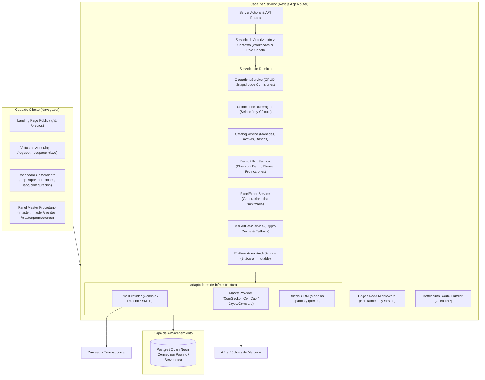

# Arquitectura del Sistema — Cyclon P2P

Este documento describe la arquitectura lógica, estructural y de seguridad de **Cyclon P2P**.

## 1. Diagrama de Arquitectura Lógica



## 2. Capas y Responsabilidades

### 2.1 Capa de Presentación (UI)
- **React Server Components (RSC):** Renderizado del lado del servidor por defecto para recuperación rápida de datos sin cascadas de peticiones.
- **Client Components (`'use client'`):** Utilizados estrictamente para componentes interactivos (formularios reactivos, modales, gráficos interactivos, selectores en cascada y menús desplegables).
- **Estética Visual:** Tema oscuro grafito (`#0a0b0e`) con detalles verde neón (`#00FF66`). Tipografía clara y contraste alto.

### 2.2 Capa de Validación y Autorización (Security Barrier)
- **Validación:** Esquemas Zod en todos los límites de entrada (`src/lib/validation/`). No se procesa ninguna mutación sin validación previa.
- **Autorización por Workspace:**
  - El `workspaceId` se deriva siempre de la sesión del usuario obtenida del token de sesión verificado en el servidor.
  - **Prohibido:** Aceptar `workspaceId` enviado por el navegador en peticiones POST/PUT/DELETE.
- **Autorización Master:**
  - El rol `platform_owner` se comprueba estrictamente en el servidor en cada ruta bajo `/master` y cada acción del panel administrativo.

### 2.3 Capa de Dominio (Domain Services)
- Lógica de negocio pura, desacoplada del framework y de la base de datos directa.
- **Snapshot inmutable de comisiones:** Al registrar una operación, se guarda la tasa calculada y la regla utilizada (`commission_rule_snapshot`), garantizando trazabilidad ante cambios futuros en las reglas.
- **Motor de Comisiones determinista:** Resolución de prioridad jerárquica:
  1. `País + Moneda + Lado + Exchange + Método de Pago`
  2. `País + Moneda + Lado`
  3. `País + Moneda`
  4. Si no hay regla: estado "Sin regla configurada" (permite ajuste manual justificado).
- **Demo Billing:** Administrado por `DemoBillingService` (`BILLING_MODE=demo`), asegurando que todos los registros de suscripciones porten `simulated=true`.

### 2.4 Capa de Persistencia y ORM
- **Drizzle ORM:** Definición de esquemas fuertemente tipados en TypeScript, migraciones versionadas y consultas SQL parametrizadas a través del driver `@neondatabase/serverless` o `pg`.
- **Integridad de Datos:** Claves foráneas con restricciones `ON DELETE RESTRICT` en entidades transaccionales para evitar pérdidas de historial contable. Tipos `numeric(18, 8)` para activos cripto y `numeric(15, 2)` o `numeric(18, 4)` para importes fiat y comisiones.

## 3. Estrategia de Aislamiento de Datos (Multi-Tenant)

Cada consulta de datos de comerciante contiene obligatoriamente la cláusula:
```sql
WHERE workspace_id = $auth_workspace_id
```
Nunca se expone la clave primaria autoincremental de una operación en endpoints públicos sin contrastar su propiedad con el workspace autenticado.
